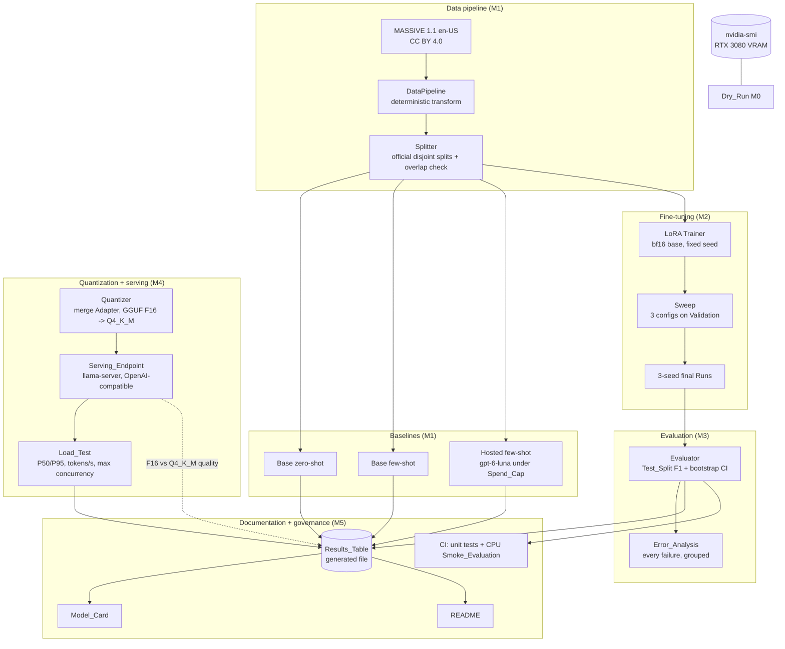

# Design Document

## Overview

Fine-Tune and Serve fine-tunes a small open-weight language model (the Base_Model) on **one narrow task** on a single NVIDIA RTX 3080, proves the Finetuned_Model beats prompting the Base_Model alone, then quantizes and serves it behind an OpenAI-compatible endpoint with measured latency and throughput. The System is parameter-efficient (LoRA), seed-fixed, and fully reproducible: every reported number is a Measured_Value produced by a repository script and recorded with its generating command, seed, and full 40-character commit hash (Req 0.1).

The concrete choices, all made in this document so the plan runs without owner decisions: the Base_Model is **Qwen2.5-1.5B-Instruct** (Apache 2.0), fine-tuned with **LoRA on bf16 base weights**; the Task is **intent-and-slot extraction to JSON** on the English part of the **MASSIVE** dataset (CC BY 4.0), scored by **field-level F1**; the hosted baseline is OpenAI **`gpt-6-luna`** under a **$2.00 Spend_Cap**; the served model is a **llama.cpp GGUF Q4_K_M** quantization behind **`llama-server`**.

### Problem

ML-engineer postings ask for the full loop — training, evaluation, model optimization, and deployment — not just calling a hosted API. A portfolio artifact must therefore show a real fine-tuning Run that measurably beats a prompting baseline on a held-out Test_Split, a quantized model served at measured latency/throughput on consumer hardware, and documentation (Model_Card, README) in which every number is traceable to a generated file. It must also stay defensible: the chosen model/method/sequence-length must be *proven* to fit in ~10 GB of VRAM before a full Run is committed, and every dependency, model, and dataset must be license-checked (portfolio-rules.md, Req 0).

### Solution shape

A thin, testable pipeline wraps a reused fine-tuning library, a reused serving runtime, and a locally served quantized model:

```
MASSIVE en-US -> DataPipeline (deterministic transform, official disjoint splits, overlap check)
        -> Baselines (base zero-shot, base few-shot, hosted few-shot)  [Test_Split, field-level F1, bootstrap CI]
        -> LoRA Trainer (bf16 base, fixed seed, loss curve + config + commit per Run)
        -> Sweep (3 configs on Validation_Split) -> Final_Configuration -> 3 seed Runs
        -> Evaluator (Test_Split F1 + 95% bootstrap CI + grouped error analysis of every failure)
        -> Quantizer (merge Adapter, GGUF F16 -> Q4_K_M) -> Serving_Endpoint (llama-server, OpenAI-compatible)
        -> pre/post-quant quality (F16 vs Q4_K_M, same server) + Load_Test (P50/P95 ms, tokens/s, max concurrency)
        -> Results_Table (generated) -> Model_Card + README (generated, every number traceable)
```

The Test_Split is touched **only** by the evaluator and the baselines; model selection and step counts use Train/Validation only (Req 4.7). `ModelClient` is strictly OpenAI-compatible so the same client drives the hosted baseline, the local served model, and the Load_Test.

### Milestone mapping (summary)

Work is delivered in milestones M0–M5, each ending in an automated verification gate run by the agent (no owner review stop). The owner's only inputs are given before the run: an OpenAI API key, stored outside the repository, and optionally a different Spend_Cap written into this document. A full table appears in the final **Milestone Mapping** section.

| Milestone | Delivers |
| --- | --- |
| M0 | GPU environment proof + VRAM Dry_Run + hosted API proof (Req 1) |
| M1 | Task + data pipeline (official, overlap-checked splits) + metric + baselines (Req 2, 3) |
| M2 | LoRA fine-tuning Runs + 3-config Sweep + 3-seed final (Req 4) |
| M3 | Evaluation with bootstrap CIs + grouped error analysis (Req 5) |
| M4 | Quantization + OpenAI-compatible serving + Load_Test + pre/post-quant quality (Req 6, 7) |
| M5 | Results_Table, plots, Model_Card, README, tests, CI smoke evaluation (Req 8, 9, 10) |

## Architecture

### Component diagram



### Train / evaluate / serve sequence

```mermaid
sequenceDiagram
    participant O as Agent / script
    participant DP as DataPipeline
    participant TR as LoRA Trainer
    participant EV as Evaluator
    participant QZ as Quantizer
    participant EP as Serving_Endpoint
    participant LT as Load_Test

    O->>DP: build splits (official MASSIVE partitions)
    DP->>DP: deterministic transform; assert Train/Val/Test disjoint (Req 2.4)
    DP-->>O: Train / Validation / Test (counts as Measured_Values, Req 2.7)
    O->>TR: sweep(3 configs) on Validation (Req 4.3)
    TR-->>O: Final_Configuration + justifying Val metric (Req 4.4)
    O->>TR: final Runs x3 seeds (Req 4.5), record loss/config/seed/commit (Req 4.2)
    TR-->>EV: Adapters
    EV->>EV: Test_Split F1 + 95% bootstrap CI per seed (Req 5.1); mean+spread over seeds (Req 5.3)
    EV->>EV: Error_Analysis: every failure grouped; group counts sum (Req 5.4, 5.5)
    EV-->>O: Finetuned_Model result vs baselines (same Test_Split + metric, Req 5.2)
    O->>QZ: merge Adapter, convert to GGUF F16, quantize to Q4_K_M (Req 6.1)
    O->>EP: start OpenAI-compatible endpoint (Req 6.2, 6.6); verify VRAM <= nvidia-smi (Req 6.4)
    EP-->>O: F16 and Q4_K_M Test_Split F1 + CI (Req 6.3)
    O->>LT: drive concurrency schedule (Req 7)
    LT-->>O: P50/P95 ms, tokens/s, max concurrency; failed requests excluded from stats (Req 7.1-7.5)
```

### Data and control flow notes

- The Dry_Run at M0 is the gate: a Base_Model/method/sequence-length whose measured peak VRAM exceeds `nvidia-smi` total is rejected before any full Run (Req 1.4, 1.5).
- Splits come from MASSIVE's official partitions and are verified pairwise disjoint; the overlap check reports every offending example id and the count, and exits non-zero on overlap (Req 2.4).
- Few-shot exemplars come **only** from the Train_Split, and the label lists in the prompts are built from the Train_Split only, so the Test_Split never leaks into a prompt (Req 3.5).
- Model selection and step counts are decided on Train/Validation only; the Test_Split is consumed only by the evaluator and the baselines, keeping the final numbers honest (Req 4.7, 5.2).
- `ModelClient` is strictly OpenAI-compatible, so the hosted baseline, the local served model, and the Load_Test share one client.

## Technology Choices and Rationale

Exact library versions, the Base_Model revision, image digests, and licenses are **proven at the milestone where they are first used and recorded in `docs/ENVIRONMENT.md`** with a verifiable artifact (Req 0.5, 0.6, 1.6) and in `THIRD_PARTY.md` (Req 0.7). This section records the decisions and contains **no measured numbers** (those are Measured_Values produced at M0–M4). Facts quoted from outside sources carry their access date.

### Platform, language, tooling

- **Windows 11 + WSL2 `Ubuntu-24.04`, Python 3.11+** — training, evaluation, and every script run inside WSL (Ubuntu 24.04 ships Python 3.12); the Python version is verified at M0 (Req 1.2). Git and the GitHub CLI run on Windows. See "Execution environment" below.
- **uv** — creates the environment and the lockfile (`uv.lock`), so every dependency is pinned exactly (Req 0.10). PyTorch comes from PyPI, whose Linux wheels target CUDA 13.0 as of PyTorch 2.11.0 (uv's PyTorch guide, accessed 2026-10-17); the same lockfile installs on the GPU desktop and on CPU-only CI, where PyTorch runs on the CPU. If the CI runner runs out of disk space for the CUDA wheels, CI switches to PyTorch's CPU index using uv's documented optional-dependency pattern, and the change is recorded.
- **Docker Engine + NVIDIA Container Toolkit inside WSL** (installed for the previous project) — runs the llama.cpp conversion and serving images.
- **pytest + pytest-cov + Hypothesis** — unit tests (>=80% statement coverage per non-trivial module, Req 0.11) and property-based tests for the pure-logic properties.
- **NumPy / SciPy** — bootstrap resampling for Confidence_Intervals (Req 3.2, 5.1) and summary statistics.
- **matplotlib** — the generated loss-curve and sweep/quality plots for the README (Req 10.2).
- **GitHub Actions** — the CI_Pipeline runs on every push and pull request (a superset of Req 9.2) on a GitHub-hosted `ubuntu-latest` runner. CI is CPU-only: unit tests plus the tiny CPU Smoke_Evaluation (Req 9.3), never a GPU training Run. The repository is `https://github.com/OctaviusLeo/Finetune-And-Serve`, private (Req 0.12).

### Base_Model

**Decision: `Qwen/Qwen2.5-1.5B-Instruct`**, pinned to the Hugging Face revision (commit hash) downloaded at M0. Facts from its model card (accessed 2026-10-17): Apache-2.0 license, not gated, 1.54B parameters, 28 layers, 12 query and 2 key/value attention heads, 32,768-token context, requires `transformers` >= 4.37.

Rationale against the original 7–8B QLoRA recommendation: a 1.5B model trains with plain LoRA on bf16 weights with wide VRAM headroom on a 10 GB card; each Run is several times faster, so the 3-config Sweep, the 3-seed final, and full-Test evaluation fit in one unattended run; and merging the Adapter and converting to GGUF need about 3 GB of RAM instead of about 15 GB, which matters because WSL gets only part of the PC's memory. The Dry_Run still measures the peak (Req 1.3–1.5).

### Fine-tuning library and PEFT method

- **Hugging Face `transformers` + `peft` + `accelerate`** (with `trl` only if its trainer is used); no `bitsandbytes`, because neither training nor serving needs it.
- **PEFT method: LoRA on bf16 base weights** (most Base_Model weights frozen, Req 4.1), target modules `q_proj`, `k_proj`, `v_proj`, `o_proj`, `gate_proj`, `up_proj`, `down_proj`, LoRA dropout 0.05, gradient checkpointing on.
- **Fixed settings for every Run:** `max_seq_len` 256 tokens, per-device batch 8 with gradient accumulation 2 (effective batch 16), 2 epochs, linear learning-rate decay with 3% warmup, loss computed on the assistant (JSON) tokens only, seeded data order, logging every 10 optimizer steps, only the final Adapter saved (no intermediate checkpoints).
- **Determinism settings:** `torch.use_deterministic_algorithms(True, warn_only=True)`, `CUBLAS_WORKSPACE_CONFIG=:4096:8`, `torch.backends.cudnn.benchmark = False`, seeds set for Python, NumPy, and PyTorch.
- If the data pipeline reports a tokenized example longer than 256 tokens, `max_seq_len` becomes the next power of two above the longest example, and the Dry_Run is repeated at that value.
- **VRAM fallback:** if the Dry_Run's peak exceeds the `nvidia-smi` total or runs out of memory, halve the per-device batch and double gradient accumulation (the effective batch stays 16), down to a per-device batch of 2, and record the reason. If it still does not fit, that is a blocker.

### Task, Dataset, and Task_Metric

**Task (Req 2.1):** given an English voice-assistant utterance, output one JSON object with its intent and slots:

```json
{"intent": "alarm_set", "slots": [{"type": "time", "value": "five am"}, {"type": "date", "value": "this week"}]}
```

**Dataset (Req 2.2):** MASSIVE 1.1, English (`en-US.jsonl`) only, from `https://amazon-massive-nlu-dataset.s3.amazonaws.com/amazon-massive-dataset-1.1.tar.gz`. MASSIVE is licensed CC BY 4.0, and the SLURP text it derives from is CC BY 4.0 (MASSIVE `NOTICE.md`, accessed 2026-10-17). Each record has `id`, `locale`, `partition` (`train`, `dev`, or `test`), `scenario`, `intent` (formatted `{scenario}_{intent}`), `utt`, and `annot_utt`, whose slots are marked `[label : entity]`. The English part has 11,514 train, 2,033 dev, and 2,974 test records (Hugging Face dataset card, accessed 2026-10-17). `scripts/build_data.py` records the tarball's SHA-256, URL, and access date.

**Transform (Req 2.5, 2.6):** parse the `[label : entity]` spans of `annot_utt` in order. An example is excluded, with its id and reason reported and the excluded total recorded, if the brackets don't balance, a span lacks ` : `, the intent is empty, or removing the markup does not reproduce `utt` (after collapsing whitespace). The target is the JSON above, serialized with `json.dumps(obj, ensure_ascii=False)` so the same raw example always yields the same string.

**Splits (Req 2.3, 2.4, 2.7):** the official partitions: `train` → Train_Split, `dev` → Validation_Split, `test` → Test_Split. Membership is fixed by the dataset, so it is identical on every run; the seed is still recorded. The overlap check compares example ids. Utterance texts that appear in more than one split are counted and reported (not failed) as a stated limitation. The processed splits are committed as `data/massive_en/{train,validation,test}.jsonl`.

**Task_Metric: field-level F1, range [0, 1] (Req 2.1).** For one example, the gold and predicted fields are multisets of pairs: `("intent", intent)` plus `(slot_type, value)` for every slot, with values lowercased, trimmed, and internal whitespace collapsed. Matches are counted with multiplicity. Precision = matches / predicted pairs, recall = matches / gold pairs, F1 = 2PR / (P + R), and F1 = 0 when there are no matches. A prediction counts as invalid, and scores 0, when no JSON object with a string `intent` and a list `slots` of `{type, value}` string objects can be parsed from the first `{...}` block of the output. The aggregate is the mean per-example F1. Hand-computed example: gold `{alarm_set; time: five am; date: this week}`, prediction `{alarm_set; time: five am}`: P = 2/2, R = 2/3, F1 = 0.8.

**Failure (Req 5.4):** an example whose F1 is below 1.0.

### Prompts and few-shot exemplars

- Every local prompt is a chat with the same explicit system message (`config/prompts/system.txt`), applied through the tokenizer's chat template, so the model's default system message never appears.
- `config/prompts/finetune.txt` — the compact user message used for training, evaluating the Finetuned_Model, and serving: the instruction and the utterance.
- `config/prompts/zero_shot.txt` — the instruction, the output format, the list of every intent and every slot type (built from the Train_Split only, stored in `config/labels.json`), and the utterance.
- `config/prompts/few_shot.txt` — the zero-shot prompt plus 10 exemplars shown as prior user/assistant turns. They are chosen by `scripts/select_exemplars.py`: shuffle the Train_Split with seed 0 and take the first example of each of 10 distinct scenarios. They are stored in `config/few_shot_exemplars.json` (Req 3.5, 3.6).
- The hosted baseline uses the few-shot messages unchanged. The Results_Table states that each system is measured with its own recorded template.

### Local inference for baselines and evaluation

All Test_Split and Validation_Split numbers for the Base_Model and the Finetuned_Model (Req 3, 4, 5) come from one engine: Hugging Face `transformers` generation in bf16, greedy (`do_sample=False`), `max_new_tokens` 128, left padding, examples in dataset order, batch 32 for the compact prompt and 8 for the long baseline prompts. The Adapter is applied with `peft` without merging. Predictions are saved per example under `runs/predictions/`.

### Hosted model and Spend_Cap

- **Model:** OpenAI `gpt-6-luna`, called through Chat Completions at `https://api.openai.com/v1` with `reasoning_effort: "none"` and `max_completion_tokens: 128`. Facts from OpenAI's model and pricing pages (accessed 2026-10-17): it supports Chat Completions and the reasoning-effort values `none` through `max`. Its Standard prices per 1M tokens are $0.10 input, $0.01 cached input, $0.125 cache writes, and $0.50 output, with higher rates only for prompts over 272K tokens. The pages don't say whether `temperature` or `seed` are accepted.
- **Parameters:** the client sends `temperature: 0` and `seed`. If the API rejects either, the client drops it, and the run records that in `docs/ENVIRONMENT.md`. Any nondeterminism is then provider-documented (Req 0.3). Each response's `model` field is recorded.
- **Key:** read only from the environment variable `OPENAI_API_KEY` (Req 0.9, 0.13). `scripts/wsl_run.sh` exports it from `~/.config/fts/secrets.env`, which the owner creates outside the repository. It is never printed or logged.
- **Spend accounting (Req 3.3, 3.4):** cost per request = prompt_tokens × $0.125 / 1M + completion_tokens × $0.50 / 1M. Every prompt token is charged at the higher of the input and cache-write rates, so the recorded spend is an upper bound on the bill. Every hosted request in the project, including the M0 check, is appended to `results/hosted_ledger.jsonl`. Before each request, the client adds a worst case (prompt length estimated as characters ÷ 3, plus 128 output tokens) to the ledger total. If that would exceed the Spend_Cap, it stops before sending, reports the spend reached and the cap, and exits non-zero.
- **Spend_Cap:** $2.00, set here by the owner; a different value written here before the run replaces it. Task 1.3 copies it into `config/hosted.yaml` as `spend_cap_usd`, and no later task raises it. Planning estimate for the few-shot baseline on all 2,974 Test examples, at 900–1,600 prompt tokens and 30–80 output tokens per request: $0.38–$0.71.

### Quantization and serving runtime

- **Decision:** llama.cpp. The serving seed's Adapter is merged into the bf16 Base_Model (`merge_and_unload`) and saved with its tokenizer. It is converted to a GGUF F16 file and then quantized to GGUF Q4_K_M (method `gguf-q4_k_m`, nominal bit width 4; Req 6.1). Conversion and quantization use the llama.cpp `full-b<build>` image (`--convert` runs `convert_hf_to_gguf.py`, `--quantize` runs `llama-quantize`). Serving uses `llama-server` from the `server-cuda12-b<build>` image. Both are pinned to the same build number at M4: the newest whose CUDA image exists, for example `b11580` on 2026-10-17. The image digests are recorded.
- **Why not vLLM** (the original recommendation): on 2026-10-17 its images were 9–16 GB compressed (Docker Hub), and its bitsandbytes support had moved to an out-of-tree plugin (vLLM docs). llama.cpp produces an on-disk quantized artifact, runs in a much smaller image, and serves OpenAI-compatible chat completions, with `/health` returning 503 while loading and 200 when ready.
- **Serving command (Req 6.6):** `bash scripts/serve.sh [f16|q4]` starts the `serve` service of the Compose project `fts` (`docker-compose.yml`, top-level `name: fts`). The service has a GPU reservation, the model directory `${HOME}/fts-artifacts/models` mounted read-only, port 8080, `-ngl all -np 32 -c 16384 --jinja --metrics`, and a `/health` healthcheck. The script waits for HTTP 200 from `/health`. The default model is Q4_K_M.
- **Secrets (Req 6.5):** by default the server needs no secret. With `require_api_key: true` in `config/serve.yaml`, `FTS_SERVE_API_KEY` is required. If it is unset or empty, `scripts/serve.sh` exits non-zero naming it before starting anything.
- **VRAM (Req 6.4):** `nvidia-smi --query-gpu=memory.used,memory.total` is sampled once per second while the server is up during the quality evaluation and the Load_Test. The peak must not exceed the total.
- **Pre/post-quantization quality (Req 6.3):** the F16 and Q4_K_M files are each served by the same `llama-server` and evaluated on the whole Test_Split with the Task_Metric and a 95% CI. Requests are sent one at a time with `temperature: 0`, `seed`, and the compact prompt. The Hugging Face-evaluated F1 of the same seed is shown beside them for reference.

### Load test schedule and sustaining criterion (Req 7)

- **Target:** the Q4_K_M model on `llama-server` (32 slots).
- **Schedule:** concurrency levels 1, 2, 4, 8, 16, 32. At each level: 5 untimed warm-up requests, then 128 timed requests. Prompts are drawn with seed 0 from Test utterances in the compact format, with `max_tokens` 128, `temperature` 0, and a 60-second timeout.
- **Measures per level:** P50 and P95 latency in ms over successful requests; tokens/s = completion tokens of successful requests ÷ wall-clock time of the level (from the response `usage`, or the model's tokenizer if `usage` is absent); failed and timed-out requests are counted and excluded from both (Req 7.5).
- **Sustaining criterion:** a level is sustained when no request fails and P95 latency is at most 2,000 ms. The maximum concurrency is the highest sustained level in the schedule (Req 7.3).
- **Stamps:** every level is recorded with its command, seed, concurrency level, and full commit hash (Req 7.4) in `results/loadtest.json`.

### Execution environment (where the tasks run)

Kiro runs every task on the owner's Windows 11 desktop with the RTX 3080.

| Item | Value |
| --- | --- |
| Repository root | `C:\dev\Finetune-And-Serve` (WSL path `/mnt/c/dev/Finetune-And-Serve`) |
| Python environment | `~/.venvs/fts` on the Linux filesystem, created with `uv` (`UV_PROJECT_ENVIRONMENT`) |
| Large artifacts | `~/fts-artifacts/` on the Linux filesystem: `adapters/`, `models/` (merged model, GGUF files); never committed (Req 0.12) |
| Hugging Face cache | `~/.cache/huggingface` |
| Hosted API key | `~/.config/fts/secrets.env` (created by the owner, mode 600), exported by `scripts/wsl_run.sh` |
| Docker | Docker Engine with the NVIDIA Container Toolkit inside WSL; Compose project `fts` with the `serve` service |
| Helper scripts | `scripts/wsl_run.sh` (runs one command in WSL from the repository root with the environment set), `scripts/bg.sh` and `scripts/bg_status.sh` (start and poll detached jobs), `scripts/test_unit.sh` (the hosted-CI test command); the first three are written exactly as in `.kiro/steering/environment.md` |

**Rules that keep an unattended run safe and repeatable**
- **Commands:** run Python, Docker, and shell scripts inside WSL from PowerShell through the wrapper: `wsl -d Ubuntu-24.04 -- bash /mnt/c/dev/Finetune-And-Serve/scripts/wsl_run.sh <command>`. Anything with `$`, pipes, `&&`, redirection, or nested quotes goes into a script under `scripts/`, because PowerShell expands `$` inside double quotes before WSL sees it. Shell scripts always run as `bash scripts/<name>.sh`. Git and `gh` run only from PowerShell, except the reproducibility helper's two read-only commands (`git rev-parse HEAD` and `git --no-optional-locks status --porcelain`). `.gitattributes` holds `* text=auto eol=lf` plus `*.png binary` and `*.gif binary`.
- **One GPU job at a time.** The Dry_Run, training, local evaluation, quantization, and serving never overlap. At the start of task 1.6, with nothing of this project running, record the idle reading of `nvidia-smi --query-gpu=memory.used --format=csv,noheader,nounits` in `runs/gpu_idle_mib.txt`. Before starting a GPU job, read it again. If it is more than 1,024 MiB above the idle reading, wait in 5-minute steps for up to 20 minutes, because another project's container may hold a model for a few minutes. Never stop another project's containers. If memory is still above the limit, record a blocker.
- **Long jobs run detached with polling.** Kiro stops a single command after at most 30 minutes. Anything that may take longer than 10 minutes starts with `bash scripts/bg.sh <name> <command>` and is polled with `bash scripts/bg_status.sh <name>`. Examples: model downloads, the Dry_Run, training, evaluation, baselines, image pulls, conversion, the quality evaluation, and the Load_Test. A job reported `LOST` (gone without an exit file) is an environment failure recorded in `docs/BLOCKERS.md`.
- **No `sudo`.** System packages, Docker, and the NVIDIA Container Toolkit were installed by the owner. A missing one is a blocker, not something to work around.
- **Docker scope:** only the `fts` Compose project's containers may be started, recreated, or stopped. Never run `docker system prune`, `docker volume rm`, or anything that touches other projects (for example the `gqa` project), and never `wsl --shutdown` or `wsl --terminate`.
- **Numbers come from committed code.** Before any run whose numbers are reported, commit the source and record `git rev-parse HEAD`; refuse to report if `git --no-optional-locks status --porcelain` shows changes outside `results/`, `runs/`, `docs/`, `README.md`, `MODEL_CARD.md`, and `.kiro/` (Kiro updates the task list while a task runs). The check runs when the script starts, before it writes any output.
- **Retry cap.** A gate or verification that still fails after 3 fix attempts for the same cause is recorded in `docs/BLOCKERS.md` (task, command, exit code, log path, suspected cause) and that task stops. Targets and tests are never loosened to pass (Req 0.4).

## Components and Interfaces

All interface sketches are Python 3.11 with type hints and dataclasses. Signatures are illustrative of responsibilities and boundaries; code written by an earlier run of the plan may already exist and is brought in line with them.

### Data pipeline and splitter (M1)

Responsibility: load the MASSIVE English records, apply the documented deterministic transform (Req 2.5), produce the fixed pairwise-disjoint splits (Req 2.3), verify disjointness (Req 2.4), and exclude malformed examples with reporting (Req 2.6).

```python
@dataclass(frozen=True)
class Example:
    example_id: str          # MASSIVE id; stable identifier for overlap checks and reporting
    partition: str           # "train" | "dev" | "test" (official MASSIVE partition)
    inputs: str              # the utterance (utt)
    target: str              # canonical gold JSON string

@dataclass(frozen=True)
class Splits:
    train: tuple[Example, ...]
    validation: tuple[Example, ...]
    test: tuple[Example, ...]

def transform_example(raw: dict, seed: int) -> Example | None:
    """Deterministic transform of one MASSIVE record; returns None (excluded, with id + reason
    reported by the caller) for malformed input (Req 2.5, 2.6)."""

def build_splits(examples: Sequence[Example], seed: int) -> Splits:
    """Assign by the official partition; membership does not depend on the seed (Req 2.3)."""

def check_overlap(splits: Splits) -> dict[str, list[str]]:
    """Return {pair_name: [overlapping_example_ids]}; empty if disjoint. Caller reports
    every offending id + count and exits non-zero on any overlap (Req 2.4)."""
```

### Task_Metric (M1)

Responsibility: score a prediction against a gold target automatically, in `[0,1]` (Req 2.1). Pure, deterministic, unit-tested with a hand-computed expected value (Req 9.1, 9.5).

```python
def parse_prediction(text: str) -> "Parsed | None":
    """First {...} block parsed as {"intent": str, "slots": [{"type": str, "value": str}]}; None if invalid."""

def score_example(prediction: str, gold: str) -> float:
    """Field-level F1 over (field, normalized value) multisets, in [0,1]. Invalid prediction -> 0.0."""

def aggregate(scores: Sequence[float]) -> float:
    """Mean over scored examples, in [0,1]."""
```

### ModelClient and spend ledger (M0, reused M1/M4)

Responsibility: call any OpenAI-compatible endpoint (hosted baseline, local `llama-server`); fail fast on a missing secret; enforce timeouts; retry 429/5xx with exponential backoff up to 5 attempts; count tokens for cost; enforce the Spend_Cap (Req 0.13, 3.3, 3.4, 6.5).

```python
class ModelClient:
    def __init__(self, base_url: str, model: str, api_key_env: str | None,
                 timeout_s: float, seed: int, extra: dict | None = None,
                 ledger: "SpendLedger | None" = None) -> None:
        """If api_key_env is required and unset/empty, raise before any request and
        exit non-zero naming the variable (Req 0.13, 6.5)."""
    def complete(self, messages: list[dict], max_tokens: int) -> "Completion": ...

@dataclass(frozen=True)
class Completion:
    text: str
    prompt_tokens: int
    completion_tokens: int
    model: str                                 # as returned by the server

class SpendLedger:
    """Append-only results/hosted_ledger.jsonl; conservative cost formula; refuses a request whose
    worst-case cost would push the total above the Spend_Cap (Req 3.3, 3.4)."""
```

### Baselines runner (M1)

Responsibility: evaluate Base_Model zero-shot, Base_Model few-shot (exemplars from Train_Split only), and Hosted_Model few-shot on the Test_Split; report each Task_Metric with a 95% bootstrap CI; enforce the Spend_Cap (Req 3).

```python
@dataclass(frozen=True)
class BaselineResult:
    name: str                       # "base_zero_shot" | "base_few_shot" | "hosted_few_shot"
    metric: "BootstrapCI"           # Task_Metric point + 95% CI (Req 3.2)
    spend_usd: float                # 0.0 for local baselines; hosted from the ledger (Req 3.3)
    prompt_template: str            # path of the recorded template (Req 3.6)
    not_scored: int                 # malformed Test examples skipped with cause (Req 5.8)

def run_baselines(splits: Splits, few_shot_exemplars: Sequence[Example],
                  spend_cap_usd: float, seed: int) -> list[BaselineResult]: ...
```

### LoRA Trainer (M2)

Responsibility: fine-tune the Base_Model with LoRA at a fixed seed, producing an Adapter, a loss curve, and a recorded config/seed/commit per Run (Req 4.1, 4.2).

```python
@dataclass(frozen=True)
class TrainConfig:
    name: str                    # "A" | "B" | "C"
    lora_r: int
    lora_alpha: int
    learning_rate: float
    epochs: float                # 2
    max_seq_len: int             # 256
    per_device_batch_size: int   # 8
    grad_accum: int              # 2
    seed: int

@dataclass(frozen=True)
class RunRecord:
    run_id: str
    adapter_path: str                           # relative to ~/fts-artifacts
    loss_curve: tuple[tuple[int, float], ...]   # (optimizer step, training loss)
    config: TrainConfig
    val_metric: float                           # Validation field-level F1
    commit: str                                 # full 40-char hash (Req 4.2)

class PEFTTrainer:
    def train(self, splits: Splits, config: TrainConfig) -> RunRecord:
        """LoRA on bf16 base; logs loss; records config+commit to results/runs/<run_id>.json.
        Uses Train/Validation only; never Test (Req 4.7)."""
```

### Sweep (M2)

Responsibility: evaluate the 3 documented configs on the Validation_Split, record the written rationale, and select the Final_Configuration by the Validation Task_Metric (Req 4.3, 4.4).

| Config | `lora_r` | `lora_alpha` | learning rate |
| --- | --- | --- | --- |
| A | 8 | 16 | 2e-4 |
| B | 16 | 32 | 2e-4 |
| C | 16 | 32 | 1e-4 |

Rationale (written to `docs/SWEEP_RATIONALE.md` before the sweep runs): rank and learning rate are the LoRA settings quality is most sensitive to. A versus B isolates rank at a fixed learning rate, B versus C isolates learning rate at a fixed rank, and the other settings are fixed above. All sweep Runs use seed 1. The selection is the highest Validation F1, with ties going to the earlier config in the table. Planning figure: with 2,033 Validation examples and a per-example F1 standard deviation near 0.25, a 95% CI half-width is about 0.011, so smaller differences are within noise.

```python
@dataclass(frozen=True)
class SweepResult:
    configs: tuple[TrainConfig, ...]            # 3 configs (Req 4.3)
    val_metrics: dict[str, float]              # config name -> Validation F1
    selected: TrainConfig                       # Final_Configuration (Req 4.4)
    rationale_path: str                         # docs/SWEEP_RATIONALE.md (Req 4.3)

def run_sweep(splits: Splits, configs: Sequence[TrainConfig]) -> SweepResult: ...

def run_final_seeds(splits: Splits, final: TrainConfig, seeds: Sequence[int]) -> list[RunRecord]:
    """Seeds 1, 2, 3; the seed-1 Run of the selected config from the sweep is reused, so two new
    Runs are trained (Req 4.5). Serving seed = highest Validation F1, ties to the lowest seed."""
```

### Evaluator and Error_Analysis (M3)

Responsibility: compute the Finetuned_Model's Test_Split Task_Metric with a 95% bootstrap CI for every final seed, the mean and spread across seeds, and the grouped Error_Analysis; deterministic and resilient (Req 5).

```python
@dataclass(frozen=True)
class BootstrapCI:
    point: float
    lower: float
    upper: float                                # lower <= point <= upper

def bootstrap_ci(samples: Sequence[float], seed: int,
                 resamples: int = 1000, confidence: float = 0.95) -> BootstrapCI:
    """95% percentile CI from >=1000 resamples (Req 3.2, 5.1); built in M1."""

@dataclass(frozen=True)
class SeedSummary:
    per_seed: dict[int, float]                  # seed -> Test F1
    mean: float
    spread: float                               # sample standard deviation across seeds (Req 5.3)

@dataclass(frozen=True)
class FailureGroup:
    group: str
    count: int

@dataclass(frozen=True)
class ErrorAnalysis:
    analyzed: int                               # every failure of the serving seed (>=50 when available)
    groups: tuple[FailureGroup, ...]            # sum(counts) == analyzed (Req 5.5)

def evaluate(run: RunRecord, splits: Splits, seed: int) -> BootstrapCI: ...
def error_analysis(predictions: Sequence[tuple[Example, str]]) -> ErrorAnalysis: ...

# Single entry point: `python -m fts.eval --config ... --seed ...` (Req 5.6).
# Missing/malformed Test example => reported "not scored" + cause, others continue (Req 5.8).
```

**Failure-type taxonomy (Req 5.4).** Each failure (F1 < 1) goes to exactly one group, the first that applies in this order:
1. `invalid_output` — no valid JSON object of the required shape.
2. `wrong_intent` — the predicted intent differs from the gold intent.
3. `missing_slot` — for some slot type, the prediction has fewer slots than the gold.
4. `extra_slot` — for some slot type, the prediction has more slots than the gold.
5. `wrong_slot_value` — everything else: same intent and same slot types and counts, but at least one value differs.

The fifth group catches every remaining failure, so the group counts always sum to the number analyzed. Five examples per group are saved for the Model_Card.

### Quantizer and Serving_Endpoint (M4)

Responsibility: merge the Adapter, convert and quantize, serve OpenAI-compatible, verify VRAM fit, and fail fast on a missing secret (Req 6).

```python
@dataclass(frozen=True)
class QuantizedModel:
    path: str                                   # relative to ~/fts-artifacts
    method: str                                 # "gguf-f16" (pre-quant reference) | "gguf-q4_k_m" (Req 6.1)
    bit_width: int                              # 16 | 4 (nominal; llama-quantize also reports bits per weight)

def quantize(base_model: str, run: RunRecord, image: str) -> tuple[QuantizedModel, QuantizedModel]:
    """Merge -> GGUF F16 -> GGUF Q4_K_M; records both in results/quantization.json."""
```

### Load_Test (M4)

Responsibility: drive concurrent requests at the Serving_Endpoint and report P50/P95 latency (ms), tokens/s, and max sustained concurrency, excluding failed requests from stats (Req 7).

```python
@dataclass(frozen=True)
class LevelReport:
    concurrency_level: int
    p50_latency_ms: float
    p95_latency_ms: float                       # p50 <= p95 (Req 7.1)
    tokens_per_second: float                    # (Req 7.2)
    failed_requests: int                        # excluded from latency/throughput (Req 7.5)
    sustained: bool                             # documented criterion (Req 7.3)

@dataclass(frozen=True)
class LoadTestReport:
    levels: tuple[LevelReport, ...]
    max_concurrent_requests: int
    seed: int
    command: str
    commit: str                                 # full 40-char hash (Req 7.4)

def run_load_test(base_url: str, model: str, concurrency_levels: Sequence[int],
                  seed: int) -> LoadTestReport: ...

# Single entry point: `python -m fts.loadtest ...` (Req 7.6).
```

### Results_Table writer and traceability check (M5)

Responsibility: generate `results/summary.md` (the only source of reported numbers) and verify every README/Model_Card number traces to a generated file (Req 10.4, 10.5).

```python
def write_results_table(results_dir: str, path: str) -> None:
    """Generates results/summary.md from results/*.json; numbers change only by regeneration (Req 10.1)."""

def check_traceability(doc_path: str, generated_sources: Sequence[str]) -> tuple[bool, list[str]]:
    """Return (ok, untraceable_numbers); ok is False and the check fails if any
    number is untraceable (Req 10.5)."""
```

`README.md` and `MODEL_CARD.md` are generated by `scripts/build_docs.py` from `docs/README.template.md` and `docs/MODEL_CARD.template.md`. Every number enters through a placeholder filled from a generated file: `results/summary.md`, `results/*.json`, `docs/ENVIRONMENT.md` evidence, or `results/doc_facts.json`, which the script writes from the configs (split sizes, seeds, schedule, prices, cap). `scripts/check_traceability.py` scans every numeric token in both files (URLs excluded) and fails on any that does not appear in those generated files.

### Reproducibility helper (shared)

```python
def commit_hash() -> str:
    """40-char hash via `git rev-parse HEAD` (Req 0.1)."""

@dataclass(frozen=True)
class Stamp:
    command: str
    seed: int
    commit: str                                 # full 40-char hash
```

## Data Models

### Example and example_id

An **Example** is an immutable, transformed MASSIVE record carrying the stable MASSIVE `id` as `example_id`, used for overlap reporting (Req 2.4) and malformed-exclusion reporting (Req 2.6). The transform is deterministic in `(raw, seed)` (Req 2.5).

### Splits

`Splits{ train, validation, test }` — the official MASSIVE partitions (Req 2.3), verified pairwise disjoint (Req 2.4). Per-split example counts are Measured_Values in `results/data_counts.json` (Req 2.7). The Test_Split is consumed only by the evaluator and baselines (Req 4.7, 5.2).

### RunRecord and TrainConfig

`RunRecord{ run_id, adapter_path, loss_curve, config, val_metric, commit }` and `TrainConfig{ name, lora_r, lora_alpha, learning_rate, epochs, max_seq_len, per_device_batch_size, grad_accum, seed }` — each Run records its loss curve, full config, seed, and full 40-char commit hash (Req 4.2), serialized as JSON in `results/runs/`. Adapters live in `~/fts-artifacts/adapters/` and are never committed.

### BootstrapCI and SeedSummary

`BootstrapCI{ point, lower, upper }` for every reported Task_Metric (Req 3.2, 5.1). `SeedSummary{ per_seed, mean, spread }` reports the mean and the sample standard deviation of the Test F1 across the 3 final seeds (Req 5.3).

### ErrorAnalysis

`ErrorAnalysis{ analyzed, groups }` with `sum(group.count) == analyzed` (Req 5.4, 5.5), in `results/error_analysis.json` with five examples per group.

### QuantizedModel and LoadTestReport

`QuantizedModel{ path, method, bit_width }` (Req 6.1) in `results/quantization.json`. `LoadTestReport{ levels, max_concurrent_requests, seed, command, commit }` with `p50 <= p95` per level and failed requests excluded from latency/throughput (Req 7.1, 7.5) in `results/loadtest.json`.

### Results_Table schema

A generated file (`results/summary.md`) with: the data counts; one row per Baseline and one per final seed plus a mean ± standard deviation row for the Finetuned_Model (Test F1 + 95% CI); the Sweep table with Validation F1; the pre- versus post-quantization quality rows (F16 and Q4_K_M, with CIs); the error-analysis group counts; the Load_Test table per concurrency level with the maximum sustained level; hosted spend versus the Spend_Cap; and, beside each section, its command, seed, and 40-character commit hash. No value is editable except by regenerating the file (Req 10.1, 10.4).

### Model_Card schema

A generated document recording intended use (converting short English voice-assistant requests into intent and slot JSON) and out-of-scope uses (other languages, long documents, safety-critical decisions) (Req 8.1), the Dataset identity, source, and Splits (Req 8.2), metric values sourced from generated files with CIs (Req 8.3), at least one Error_Analysis-supported limitation (Req 8.4), and the Base_Model (Apache 2.0) and Dataset (CC BY 4.0) licenses (Req 8.5). It states that the weights and Adapter are not published until the owner directs otherwise (Req 8.6, 0.12).

## Correctness Properties

*A property is a characteristic or behavior that should hold true across all valid executions of a system — essentially, a formal statement about what the system should do. Properties serve as the bridge between human-readable specifications and machine-verifiable correctness guarantees.*

These properties were derived from the acceptance-criteria prework and consolidated to remove redundancy (the many metric-range criteria collapse into one range property; the split criteria collapse into a disjointness property plus a determinism property). Each is implemented by a **single** Hypothesis property-based test configured for a minimum of 100 iterations (`@settings(max_examples=100, derandomize=True)`) and tagged `Feature: finetune-and-serve, Property {n}: {text}`. GPU-training behavior is **not** property-tested (it is covered by the Dry_Run and seed-determinism Run checks); properties cover the pure logic (splits, metrics, bootstrap, cost, percentiles, traceability).

### Property 1: Split disjointness and overlap reporting

*For any* set of Examples with unique ids, the Train_Split, Validation_Split, and Test_Split produced by `build_splits` are pairwise disjoint, and when a crafted overlap is injected, `check_overlap` reports exactly the overlapping example ids and the correct total count.

Generation strategy: generate Example lists with unique ids and random partitions, build splits, assert pairwise-disjoint id sets; then inject a known example into two splits and assert `check_overlap` returns exactly those ids with the right count.

**Validates: Requirements 2.3, 2.4**

### Property 2: Deterministic split membership under a fixed seed

*For any* set of Examples and *any* seed, building the splits twice with the same seed yields identical split membership, and the membership equals the official partitions.

Generation strategy: generate Example lists; call `build_splits` twice with the same seed and once with a different seed; assert the three id sets are equal across calls and match each Example's partition.

**Validates: Requirements 2.3, 2.5**

### Property 3: Deterministic transform and malformed exclusion

*For any* raw record and *any* seed, `transform_example` applied twice with the same seed produces the identical Example, and a malformed raw record (unbalanced brackets, missing ` : `, empty intent, or markup that does not reproduce `utt`) is excluded (returns `None`) deterministically.

Generation strategy: generate well-formed records from random slot spans, and malformed ones by corrupting them; assert equal output across two calls with the same seed; assert malformed inputs return `None`.

**Validates: Requirements 2.5, 2.6**

### Property 4: Task_Metric range and identity

*For any* prediction/gold pair, `score_example` lies in `[0.0, 1.0]`, and when the prediction encodes the same intent and slot multiset as the gold the score is `1.0`; `aggregate` of scores in `[0,1]` lies in `[0,1]`.

Generation strategy: generate gold records and predictions (equal, permuted, partially overlapping, invalid); assert `0.0 <= score <= 1.0`, `score == 1.0` when the multisets are equal, and aggregate within `[0,1]`.

**Validates: Requirements 2.1, 3.2, 5.1**

### Property 5: Bootstrap confidence interval brackets the point estimate

*For any* non-empty sample array of values in `[0,1]` and *any* seed, the 95% bootstrap CI computed from at least 1,000 resamples satisfies `lower <= point <= upper`, and recomputing with the same seed yields an identical interval within 1e-6.

Generation strategy: generate float arrays in `[0,1]`; compute `bootstrap_ci(samples, seed, resamples>=1000)` twice with the same seed; assert `lower <= point <= upper` and the two intervals are equal within 1e-6.

**Validates: Requirements 3.2, 5.1, 5.7**

### Property 6: Error-analysis group counts sum to the analyzed total

*For any* set of failures, the classifier assigns each failure to exactly one documented group, the reported group counts sum exactly to the number of analyzed failures, and the analyzed total is at least 50 when at least 50 failures exist.

Generation strategy: generate gold/prediction pairs with F1 < 1 of every kind; build the `ErrorAnalysis`; assert each failure has one group from the documented list, `sum(group.count) == analyzed`, and `analyzed >= min(50, available_failures)`.

**Validates: Requirements 5.4, 5.5**

### Property 7: Hosted-baseline spend-cap enforcement

*For any* sequence of per-request token counts, prices, and a Spend_Cap, the ledger reports cumulative spend equal to the defining formula over completed requests and never completes a request whose worst-case cost would push recorded spend above the Spend_Cap.

Generation strategy: generate token/price/cap sequences; simulate the request loop with the worst-case pre-check; assert reported spend equals the formula over completed requests and never exceeds the cap (the request that would cross it is not sent).

**Validates: Requirements 3.3, 3.4**

### Property 8: Few-shot exemplars never leak Test/Validation

*For any* Splits and selected few-shot exemplar set, every exemplar id is a member of the Train_Split and none is a member of the Validation_Split or Test_Split.

Generation strategy: generate Splits and run the exemplar selector; assert `exemplar_ids ⊆ train_ids` and `exemplar_ids ∩ (val_ids ∪ test_ids) == ∅`.

**Validates: Requirements 3.5, 4.7**

### Property 9: Load-test latency percentile ordering and failed-request exclusion

*For any* set of per-request outcomes (latency samples plus failed flags), the reported P50 is less than or equal to the reported P95, both are computed only over successful requests, and the reported failed-request count equals the number of failed outcomes.

Generation strategy: generate latency arrays with interleaved failures; compute the report; assert `p50 <= p95`, percentiles ignore failed samples, and `failed_requests` equals the failure count.

**Validates: Requirements 7.1, 7.5**

### Property 10: Determinism under fixed seed

*For any* seed and *any* valid input, running a deterministic System component (splitter, transform, metric, bootstrap, cost ledger) twice with the same seed and configuration produces numeric results equal within 1e-6 for floats and exactly equal for integer/categorical values, excluding timestamps, absolute file paths, and documented hardware-nondeterministic GPU-kernel variation.

Generation strategy: generate seeds and inputs; run the component twice; compare with `abs(a-b) <= 1e-6` for floats and `==` for ints/categoricals.

**Validates: Requirements 0.3, 5.7**

### Property 11: README/Model_Card number traceability

*For any* number appearing in the README or Model_Card, the traceability check passes **if and only if** that number can be traced to the Results_Table or another file generated by a repository script; an untraceable number is reported and causes the check to fail.

Generation strategy: generate document fragments mixing traceable numbers (present in a generated source file) and untraceable ones; assert the check flags exactly the untraceable numbers and returns a failed status when any exist.

**Validates: Requirements 10.4, 10.5**

## Error Handling

- **VRAM over-budget at the Dry_Run (Req 1.5):** if measured peak GPU memory exceeds `nvidia-smi` total, report the measured peak and the limit, record the failing condition in `docs/ENVIRONMENT.md`, and exit non-zero before any full Run. A CUDA out-of-memory error during the Dry_Run is reported the same way, with the limit.
- **GPU busy:** if `nvidia-smi` reports more than 1,024 MiB above the recorded idle reading before a GPU job, wait as the execution-environment rules describe; never stop another project's containers.
- **Split overlap (Req 2.4):** `check_overlap` returns the offending ids; the caller reports every id and the total count and exits non-zero.
- **Malformed Dataset example (Req 2.6):** excluded, with its id and reason reported and the total excluded count recorded; processing continues.
- **Spend-cap breach (Req 3.4):** the ledger refuses the request whose worst-case cost would exceed the Spend_Cap, the baseline reports spend reached and the cap, and exits non-zero.
- **Missing secret env var (Req 0.9, 0.13, 6.5):** any component depending on a secret (the OpenAI key, or the serving key when required) reads it from `os.environ`; if unset/empty it terminates before any request needing the secret, names the missing variable, and exits non-zero. `scripts/serve.sh` fails to start and reports the missing secret.
- **Server timeout / unavailable / rate limit:** `ModelClient` enforces a timeout, retries 429 and 5xx responses with exponential backoff up to 5 attempts, and then raises a typed error; batch/eval contexts report the cause and exit non-zero (Req 0.4). A rejected request parameter (for example `temperature` on a reasoning model) is dropped once and recorded.
- **Malformed Test example in evaluation (Req 5.8):** reported as "not scored" with its cause; remaining examples still score.
- **Failed request during the Load_Test (Req 7.5):** counted as failed, excluded from latency/throughput statistics, and reported alongside them.
- **Nondeterminism caveats (Req 0.3):** determinism is asserted only over values under our control; timestamps, absolute file paths, documented hardware-nondeterministic GPU-kernel variation, and provider-documented nondeterminism are explicitly excluded from equality checks. The seed-determinism Run check (Req 4.6) asserts training-loss equality within 1e-6 and, on a mismatch, records the largest difference and the nondeterministic kernels PyTorch names in its warn-only messages.

## Testing Strategy

The System uses a dual approach — unit tests for concrete examples/edge cases and property-based tests (Hypothesis) for the universal properties above — because this feature has substantial pure logic (splitting, metrics, bootstrap CIs, cost accounting, percentile computation, traceability) that benefits from PBT. GPU-facing behavior (the Dry_Run, training Runs, serving) is covered by the Dry_Run, seed-determinism checks, and smoke/integration tests, not PBT.

**Property-based tests (Hypothesis):**
- One property-based test per Correctness Property (11 tests), each with `@settings(max_examples=100, derandomize=True)` and tagged `Feature: finetune-and-serve, Property {n}: {property_text}`.
- Hypothesis is recorded in `THIRD_PARTY.md` / `docs/ENVIRONMENT.md`.

**Unit tests (pytest):**
- Every module with more than one public function or exceeding 50 source lines has unit tests achieving at least 80% statement coverage (Req 0.11). Logic lives in `fts/`; files in `scripts/` stay thin entry points unless they have their own tests. `scripts/check_coverage.py` applies the rule to every module in `fts/` and `scripts/`.
- The Task_Metric has a unit test with the hand-computed example above (F1 = 0.8) asserted within 1e-6 (Req 9.5).
- Explicit example tests include: overlap reporting output (Req 2.4); malformed-example exclusion (Req 2.6); spend-cap stop (Req 3.4); missing-secret fail-fast (Req 0.13, 6.5); malformed-Test "not scored" path (Req 5.8); error-analysis group-sum invariant (Req 5.5).
- Training and inference code is tested on the CPU with tiny random models built from a config in the test itself (no weight downloads), and with fakes for `nvidia-smi`, Docker, and HTTP.

**Test markers:** tests that need the GPU are marked `gpu`; tests that need Docker are marked `docker`. The hosted CI job runs `pytest -m "not gpu and not docker"` through `scripts/test_unit.sh`, and every module's coverage must come from those tests. Locally in WSL the full suite runs.

**Integration / smoke tests:**
- M0 Dry_Run: a short LoRA step that records `nvidia-smi` total VRAM and the measured peak GPU memory in `docs/ENVIRONMENT.md` and gates on the VRAM budget (Req 1.3–1.5).
- Serving: a `docker`-marked test starts the Serving_Endpoint with `scripts/serve.sh` and confirms it answers an OpenAI-compatible chat request (Req 6.2, 6.6).
- Load_Test: a single-command run that reports P50/P95, tokens/s, and max concurrency (Req 7.6).

**CPU Smoke_Evaluation in CI (Req 9.2, 9.3):** `python -m fts.smoke_eval` runs the transform, the splitter, and the Task_Metric end to end on a tiny fixed input committed under `tests/fixtures/` (no model, no network), prints a fixed expected result, and exits non-zero on any mismatch (Req 9.4).

**Single-command invocation:** the README states the exact single command that runs the unit tests and the single command that runs the Smoke_Evaluation (Req 9.6), the single command that reproduces each reported result, and the single command that starts the Serving_Endpoint (Req 10.3).

**Determinism / seed tests:** Property 10, the Run-level check that re-runs training with the same seed (Req 4.6), and an evaluator re-run on the Test_Split with the same seed (Req 5.7).

**Fabricated-number prevention:** the Results_Table, README, and Model_Card are generated files; the traceability check (Property 11) fails the build if any number cannot be traced to a generated file (Req 10.4, 10.5). Every reported number is recorded with its command, seed, and full 40-char commit hash (Req 0.1).

## Reproducibility and Governance Mapping

This design realizes the always-on portfolio rules and Requirement 0 as follows:

- **Command / seed / 40-char commit-hash recording (Req 0.1):** every script that emits a number also writes, in the same section, its generating command, integer seed, and the full 40-character commit hash. `RunRecord`, `LoadTestReport`, the baselines, and the Results_Table all carry these fields; a shared helper derives the commit hash via `git rev-parse HEAD`.
- **Configurable seeds (Req 0.2):** every randomized component (`build_splits`, `transform_example`, exemplar selection, `PEFTTrainer`, `bootstrap_ci`, baselines, Load_Test) takes an explicit `seed` parameter documented in config.
- **Determinism (Req 0.3):** enforced and tested by Property 10, the Run seed-determinism check (Req 4.6), and the evaluator determinism check (Req 5.7), with the documented exclusions.
- **Pinned dependencies (Req 0.10):** all dependencies are pinned to exact versions in `pyproject.toml` and `uv.lock`; Docker images are pinned by build tag and recorded with their digests.
- **Secrets via env vars + `.gitignore` (Req 0.9):** no secret is committed; the key file lives outside the repository; `.env` and similar files are listed in `.gitignore`; `ModelClient` and `scripts/serve.sh` read keys only from environment variables and fail fast when missing (Req 0.13, 6.5).
- **`docs/ENVIRONMENT.md` version + artifact recording (Req 0.5, 0.6):** every tool/model/dependency version is recorded with a verifiable artifact (package-manager query, docs reference, or passing test) obtained on the target machine; the M0 Dry_Run evidence block (nvidia-smi, peak VRAM, PEFT method, sequence length, batch size, command/seed/commit) is filled in at M0 (Req 1.1, 1.3, 1.8).
- **`THIRD_PARTY.md` licensing / attribution (Req 0.7, 0.8, 2.2):** every third-party package/model/dataset/image is recorded with name, version, and license identifier, including Qwen2.5-1.5B-Instruct (Apache 2.0), MASSIVE and SLURP (CC BY 4.0, with attribution), and llama.cpp (MIT).
- **Coverage + single test command (Req 0.11):** >=80% statement coverage per non-trivial module; the README states the exact single command per suite (Req 9.6).
- **Private repository, no published weights (Req 0.12):** no public license, package, or release, and no published Finetuned_Model weights or Adapter, until the owner directs otherwise; the Model_Card states non-publication (Req 8.6).

### Autonomous execution and owner inputs

Every task in `tasks.md` is implemented by the agent, including the choices made above (Base_Model, method, sequence length, Task, Dataset, metric, prompts and exemplars, sweep configurations and rationale, failure taxonomy, quantization, serving runtime, and load-test schedule) and the Model_Card and README prose. Each milestone ends with an automated gate instead of an owner review stop.

The owner's only inputs come before the run: the OpenAI API key in `~/.config/fts/secrets.env`, and optionally a different Spend_Cap written into the "Hosted model and Spend_Cap" section above. Code written by an earlier run of this plan may already exist; each task brings it in line with this design rather than starting over.

## Milestone Mapping

| Milestone | Components delivered | Requirements |
| --- | --- | --- |
| **M0** | GPU environment proof; VRAM Dry_Run; `ModelClient` + spend ledger; hosted API proof; `docs/ENVIRONMENT.md` evidence (nvidia-smi, peak VRAM, method, seq len, batch size, Spend_Cap); initial `THIRD_PARTY.md` entries | Req 1; Req 0.5–0.7, 0.13; Req 3.3–3.4 |
| **M1** | Task + Task_Metric; deterministic `DataPipeline` with official overlap-checked Splits; `bootstrap_ci`; local inference; prompts and exemplars; baselines (base zero/few-shot, hosted few-shot) with bootstrap CIs under the Spend_Cap | Req 2, 3; Req 0.8 |
| **M2** | `PEFTTrainer` (LoRA, fixed seed, loss/config/commit per Run); 3-config `Sweep` with rationale; Final_Configuration; 3-seed final Runs; training determinism check | Req 4 |
| **M3** | `Evaluator` (Test_Split F1 + 95% bootstrap CI per seed; mean+spread over seeds); `Error_Analysis` (every failure grouped); evaluator determinism re-run | Req 5 |
| **M4** | `Quantizer` (merge, GGUF F16, Q4_K_M); `llama-server` Serving_Endpoint (VRAM-checked); pre/post-quant quality; `Load_Test` (P50/P95, tokens/s, max concurrency) | Req 6, 7 |
| **M5** | Generated `Results_Table` + plots; Model_Card and README with traceability check; CPU `Smoke_Evaluation`; CI | Req 8, 9, 10; Req 0.11, 0.12 |

Each milestone ends in an automated gate before the next begins; gate failures that survive the retry cap are recorded in `docs/BLOCKERS.md` for the owner.

## Known limitations (carried into the README and Model_Card)

- **Each system has its own prompt.** The base and hosted baselines see the full intent and slot-type lists plus 10 exemplars; the Finetuned_Model sees a compact prompt. The comparison is between documented systems on the same Test_Split and metric.
- **Hosted model alias.** `gpt-6-luna` is an alias, and OpenAI retires models; the results describe the model that answered on the run date, whose `model` field is recorded.
- **Duplicate utterances.** MASSIVE's official partitions can share utterance texts; the count is reported.
- **Two inference engines.** Training-stage numbers come from Hugging Face `transformers` in bf16; the pre/post-quantization comparison and the Load_Test use `llama-server`. Numbers from the two engines are compared only within the same engine.
- **"4-bit" is nominal.** Q4_K_M mixes 4-bit and higher-precision k-quant blocks; the bits per weight reported by `llama-quantize` are recorded.
- **One GPU under WSL2.** Latency and throughput are specific to an RTX 3080 under WSL2 with the compact prompt and short outputs.
- **Weights are not published.**
