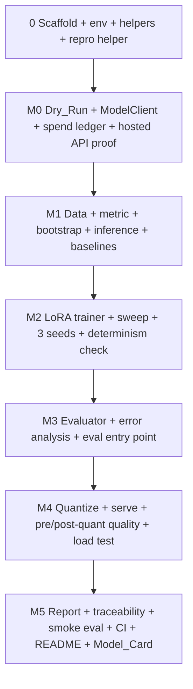

# Implementation Plan: Fine-Tune and Serve

## Overview

This plan converts the design into incremental coding tasks, organized by milestone M0–M5. It is written to run **autonomously** with Kiro's "Run all tasks": every task is agent-implementable, and every milestone ends with an **automated verification gate** (a single repository command whose exit status decides pass or fail) instead of an owner review stop. The agent moves on when the gate exits 0. If a gate exits non-zero, the agent fixes the cause and re-runs it, up to 3 fix attempts for the same failure; after that it records the failure in `docs/BLOCKERS.md` (task, command, exit code, log path, suspected cause) and stops that task. Targets and tests are never loosened to make a gate pass.

**Earlier work:** an earlier run of this plan, made before the decisions in design.md existed, already wrote code for many tasks. Every task is open again: each one brings its files in line with this plan and design.md, keeping whatever is already correct rather than starting over.

Every reported number is produced by a repository script that records its generating command, seed, and full 40-character commit hash, from committed code; the Results_Table, plots, README, and Model_Card are generated files, never hand-edited. Unit tests (≥80% statement coverage per non-trivial module) and Hypothesis property-based tests (one per Correctness Property in `design.md`, `max_examples=100`, derandomized) run from a single documented command. By every milestone gate, each non-trivial Python module has unit tests that keep it at that coverage under `bash scripts/test_unit.sh`; a task that adds such a module and has no separate test task adds those tests itself. Commit after each task (`task <id>: <summary>`).

Implementation language: **Python 3.11+** (Ubuntu 24.04's Python 3.12 in WSL), with `uv` and an exact lockfile.

**Where this runs:** on the owner's Windows 11 desktop with the RTX 3080 (design.md, "Execution environment"; `.kiro/steering/environment.md`). Python, Docker, and shell scripts run in WSL `Ubuntu-24.04` through `scripts/wsl_run.sh`; Git and `gh` run on Windows; large artifacts live in `~/fts-artifacts`. Only one GPU job runs at a time, and anything that may take longer than 10 minutes runs detached through `scripts/bg.sh` and is polled. The owner's only inputs (the OpenAI key and the Spend_Cap) are in place before the run starts.

## Task Dependency Graph



Every wave holds one task, so tasks run strictly in this order: no two tasks edit files, use Git, or use the GPU at the same time.

```json
{
  "waves": [
    { "id": 0, "tasks": ["0.1"] },
    { "id": 1, "tasks": ["0.2"] },
    { "id": 2, "tasks": ["0.3"] },
    { "id": 3, "tasks": ["1.1"] },
    { "id": 4, "tasks": ["1.2"] },
    { "id": 5, "tasks": ["1.3"] },
    { "id": 6, "tasks": ["1.4"] },
    { "id": 7, "tasks": ["1.5"] },
    { "id": 8, "tasks": ["1.6"] },
    { "id": 9, "tasks": ["1.7"] },
    { "id": 10, "tasks": ["2.1"] },
    { "id": 11, "tasks": ["2.2"] },
    { "id": 12, "tasks": ["2.3"] },
    { "id": 13, "tasks": ["2.4"] },
    { "id": 14, "tasks": ["2.5"] },
    { "id": 15, "tasks": ["2.6"] },
    { "id": 16, "tasks": ["2.7"] },
    { "id": 17, "tasks": ["2.8"] },
    { "id": 18, "tasks": ["2.9"] },
    { "id": 19, "tasks": ["2.10"] },
    { "id": 20, "tasks": ["2.11"] },
    { "id": 21, "tasks": ["2.12"] },
    { "id": 22, "tasks": ["2.13"] },
    { "id": 23, "tasks": ["2.14"] },
    { "id": 24, "tasks": ["3.1"] },
    { "id": 25, "tasks": ["3.2"] },
    { "id": 26, "tasks": ["3.3"] },
    { "id": 27, "tasks": ["3.4"] },
    { "id": 28, "tasks": ["3.5"] },
    { "id": 29, "tasks": ["3.6"] },
    { "id": 30, "tasks": ["3.7"] },
    { "id": 31, "tasks": ["3.8"] },
    { "id": 32, "tasks": ["3.9"] },
    { "id": 33, "tasks": ["4.1"] },
    { "id": 34, "tasks": ["4.2"] },
    { "id": 35, "tasks": ["4.3"] },
    { "id": 36, "tasks": ["4.4"] },
    { "id": 37, "tasks": ["4.5"] },
    { "id": 38, "tasks": ["4.6"] },
    { "id": 39, "tasks": ["4.7"] },
    { "id": 40, "tasks": ["4.8"] },
    { "id": 41, "tasks": ["5.1"] },
    { "id": 42, "tasks": ["5.2"] },
    { "id": 43, "tasks": ["5.3"] },
    { "id": 44, "tasks": ["5.4"] },
    { "id": 45, "tasks": ["5.5"] },
    { "id": 46, "tasks": ["5.6"] },
    { "id": 47, "tasks": ["5.7"] },
    { "id": 48, "tasks": ["5.8"] },
    { "id": 49, "tasks": ["5.9"] },
    { "id": 50, "tasks": ["6.1"] },
    { "id": 51, "tasks": ["6.2"] },
    { "id": 52, "tasks": ["6.3"] },
    { "id": 53, "tasks": ["6.4"] },
    { "id": 54, "tasks": ["6.5"] },
    { "id": 55, "tasks": ["6.6"] },
    { "id": 56, "tasks": ["6.7"] },
    { "id": 57, "tasks": ["6.8"] },
    { "id": 58, "tasks": ["6.9"] }
  ]
}
```

## Tasks

## Setup (prerequisite scaffolding)

- [x] 0.1 Bring the repository scaffold, environment, helper scripts, and GitHub remote in line with the design
  - Keep the `fts/` package, `tests/`, and `scripts/` from the earlier run, and add `config/`, `data/`, `results/`, `docs/`, and `runs/` (gitignored) where missing.
  - Delete what the earlier run left that this plan replaces: the vLLM launcher `scripts/serve.py` (task 5.3 replaces it with `scripts/serve.sh`), every file under `results/` except `.gitkeep` (this run regenerates every result), and an `.agents/` folder if one exists (another tool's notes from the earlier run; they do not apply to this plan). An earlier module that no task names, such as `fts/environment.py` or `fts/quant_eval.py`, is either reused by the task whose work it does or deleted together with its tests.
  - Make `pyproject.toml` a `uv` project with `requires-python = ">=3.11"` and one dependency set, every dependency pinned to an exact version: torch (from PyPI), transformers, peft, accelerate (and trl only if the trainer uses it), numpy, scipy, matplotlib, openai, httpx, pyyaml, pytest, pytest-cov, hypothesis. Drop `vllm`, `bitsandbytes`, and the earlier `gpu`/`test` extras split. Register the pytest markers `gpu` and `docker`. Generate `uv.lock`, and remove the earlier `requirements.txt`, which the lockfile replaces.
  - Create `scripts/wsl_run.sh`, `scripts/bg.sh`, and `scripts/bg_status.sh` exactly as written in `.kiro/steering/environment.md`.
  - Write `scripts/test_unit.sh`, the hosted-CI test command: `uv run --frozen pytest -m "not gpu and not docker"` with coverage over `fts/` and `scripts/` written to `runs/coverage.json`, then `uv run --frozen python scripts/check_coverage.py runs/coverage.json`. Write `scripts/check_coverage.py`, with its own unit tests, which fails and lists every module in `fts/` or `scripts/` that has more than one public function or more than 50 source lines and is under 80% statement coverage.
  - Create the environment with `wsl -d Ubuntu-24.04 -- bash /mnt/c/dev/Finetune-And-Serve/scripts/wsl_run.sh uv sync --frozen`. Through the same wrapper, confirm that `python -c "import torch; print(torch.__version__, torch.cuda.is_available())"` reports CUDA available and that `bash scripts/test_unit.sh` exits 0.
  - `.gitignore`: every secret-bearing file (`.env`, `*.env`), `runs/`, `.venv/`, `__pycache__/`, `.pytest_cache/`, `.hypothesis/`, `.coverage`, `htmlcov/`, and model files (`*.safetensors`, `*.gguf`, `*.bin`, `adapters/`). `.gitattributes` exactly as design.md specifies.
  - Make sure `docs/ENVIRONMENT.md` and `THIRD_PARTY.md` exist with section headers and that `README.md` states the repository is private.
  - From PowerShell: if the folder is not a Git repository, run `git init -b main`; otherwise keep its current branch. Set `origin` to `https://github.com/OctaviusLeo/Finetune-And-Serve.git` (the owner made it private and it is empty), commit, and `git push -u origin HEAD`.
  - _Requirements: 0.9, 0.10, 0.11, 0.12_

- [x] 0.2 Implement the shared reproducibility helper
  - `fts/repro.py` provides the 40-character commit hash via `git rev-parse HEAD`; a check, run when a script starts and before it writes anything, that refuses to stamp a reported result when `git --no-optional-locks status --porcelain` shows changes outside `results/`, `runs/`, `docs/`, `README.md`, `MODEL_CARD.md`, and `.kiro/`; a `Stamp` struct carrying `{command, seed, commit}`; and a serializer used by every result-emitting script. These two read-only commands are the only Git commands run against this repository from WSL; tests may create throwaway repositories in a temporary directory.
  - _Requirements: 0.1, 0.2_

- [x] 0.3 Write unit tests for the reproducibility helper
  - Assert the commit hash is 40 hex chars, the dirty-tree refusal works (in a temporary repository), and the stamp round-trips through serialization.
  - _Requirements: 0.1_

## M0 — GPU environment, VRAM dry run, and hosted API proof

- [x] 1.1 Implement the environment check and VRAM Dry_Run
  - `scripts/dry_run.py` (logic in `fts/dry_run.py`) does the following:
    - verifies Python ≥ 3.11;
    - captures `nvidia-smi` output, including total VRAM in MiB;
    - loads `Qwen/Qwen2.5-1.5B-Instruct` in bf16 at a pinned revision (on first use it resolves the current revision hash, writes it to `config/model.yaml`, and uses that revision from then on);
    - runs 20 LoRA optimizer steps at the worst case among the sweep configs: `lora_r` 16, per-device batch 8, every sequence padded to `max_seq_len`;
    - measures peak GPU memory in MiB, from `torch.cuda.max_memory_reserved()` and from `nvidia-smi` sampled once per second;
    - writes the evidence into `docs/ENVIRONMENT.md` with the command, seed, and 40-character commit hash: `nvidia-smi` output, peak VRAM, PEFT method, sequence length, per-device batch size, and the model revision.
  - If peak VRAM exceeds the total, a CUDA out-of-memory error occurs, or Python is older than 3.11, it reports the measured value and the limit or prerequisite, records the failing condition, and exits non-zero.
  - _Requirements: 1.1, 1.2, 1.3, 1.5, 1.8, 0.4_

- [x] 1.2 Write unit tests for the VRAM-budget decision and prerequisite check
  - Test that a peak-versus-total comparison flags over-budget, that an out-of-memory error is reported with the limit, and that the Python-version guard reports and fails on < 3.11, with `nvidia-smi` and torch faked.
  - _Requirements: 1.2, 1.4, 1.5_

- [x] 1.3 Implement the OpenAI-compatible `ModelClient` and the spend ledger
  - `fts/model_client.py` implements `ModelClient` as design.md describes:
    - The API key comes from `os.environ[api_key_env]` only when the config requires one. If it is required and unset or empty, the client raises before any request, names the variable, and exits non-zero.
    - It enforces a timeout and retries 429/5xx up to 5 times with exponential backoff.
    - It passes extra parameters such as `reasoning_effort`, uses `max_completion_tokens`, sends `temperature` 0 and `seed`, and drops a parameter the server rejects (recording which).
    - It returns token counts and the server's `model` field. It never logs the key.
  - `fts/spend.py` implements `SpendLedger`: the append-only `results/hosted_ledger.jsonl`, the conservative cost formula, and the worst-case pre-check that refuses a request that could push the total above `spend_cap_usd`.
  - Write `config/hosted.yaml` with the provider settings, prices (with source URL and access date), and `spend_cap_usd` set to the Spend_Cap in design.md.
  - _Requirements: 0.9, 0.13, 3.3, 3.4_

- [ ] 1.4 Write unit tests for `ModelClient`
  - Test missing-secret fail-fast (raises, names the variable, non-zero intent), timeout surfacing as a typed error, retry on 429, and dropping a rejected parameter, with the HTTP layer faked.
  - _Requirements: 0.13_

- [ ] 1.5 Write property test for hosted spend-cap enforcement
  - **Property 7: Hosted-baseline spend-cap enforcement** — reported spend equals the formula over completed requests and never exceeds the cap; the request that would cross it is not sent.
  - **Validates: Requirements 3.3, 3.4**

- [ ] 1.6 Run the Dry_Run and the hosted API proof, and record the environment
  - With nothing of this project running, record the idle `nvidia-smi --query-gpu=memory.used` reading in `runs/gpu_idle_mib.txt` (the GPU-free check in design.md compares against it). If the reading is above 3,072 MiB, another program is holding GPU memory: wait in 5-minute steps for up to 20 minutes for it to drop, and record a blocker if it doesn't. Then run `scripts/dry_run.py` detached and poll it. Confirm that the measured peak GPU memory is at most the `nvidia-smi` total. If it is over, follow design.md's VRAM fallback and record the reason.
  - Write and run `scripts/hosted_check.py`: one request through `ModelClient` and the ledger to `gpt-6-luna` with `reasoning_effort: "none"`. Record the returned `model` field, which parameters were accepted, the token counts, and the cost.
  - Record in `docs/ENVIRONMENT.md`, each with a verifiable artifact:
    - the Base_Model name, revision, quantization used for the Dry_Run (none, bf16), and license (Apache-2.0, from its model card);
    - the exact versions of torch, CUDA, transformers, peft, and accelerate (and trl if used);
    - the hosted model, prices, and the Spend_Cap in USD.
  - Record the Base_Model and every library's license in `THIRD_PARTY.md`.
  - _Requirements: 1.4, 1.6, 1.7, 1.8, 0.5, 0.6, 0.7_

- [ ] 1.7 **Automated gate (M0):** run `bash scripts/verify_m0.sh`, which checks:
  - `docs/ENVIRONMENT.md` holds the `nvidia-smi` capture with total MiB, a peak VRAM at or below the total, the PEFT method, the sequence length, the batch size, the model revision and license, the library versions, the hosted check, and the Spend_Cap, with stamps;
  - `results/hosted_ledger.jsonl` totals at most the cap;
  - `.gitignore` and `.gitattributes` hold the design's entries;
  - `bash scripts/test_unit.sh` passes.
  - Proceed when it exits 0. No manual review stop.

## M1 — Task, data pipeline, metric, and baselines

- [ ] 2.1 Implement the deterministic data pipeline and splitter
  - `fts/data.py` defines the `Example` and `Splits` dataclasses from design.md, plus:
    - `transform_example(raw, seed)`: parses MASSIVE `annot_utt` into the canonical JSON target; malformed records return `None`, and the caller reports the id, the reason, and the total excluded count.
    - `build_splits(examples, seed)`: assigns by the official partitions.
    - `check_overlap(splits)`: returns the offending ids per split pair; the caller reports every id and the total count and exits non-zero on any overlap.
    - A report of utterance texts shared across splits.
  - _Requirements: 2.3, 2.4, 2.5, 2.6_

- [ ] 2.2 Write property test for split disjointness and overlap reporting
  - **Property 1: Split disjointness and overlap reporting** — splits pairwise disjoint; injected overlap reported exactly with the correct count.
  - **Validates: Requirements 2.3, 2.4** _Requirements: 9.1_

- [ ] 2.3 Write property tests for deterministic split membership and transform
  - **Property 2: Deterministic split membership under a fixed seed** and **Property 3: Deterministic transform and malformed exclusion** — one Hypothesis test each.
  - **Validates: Requirements 2.3, 2.5, 2.6**

- [ ] 2.4 Build the dataset and record provenance
  - Write and run `scripts/build_data.py`, which does the following:
    - downloads the MASSIVE 1.1 tarball from the URL in design.md into `runs/cache/` and records its SHA-256, URL, and access date;
    - extracts the `en-US.jsonl` member, transforms every record, builds and overlap-checks the Splits, and reports shared utterance texts;
    - writes `data/massive_en/{train,validation,test}.jsonl` and `config/labels.json` (intents and slot types from the Train_Split only);
    - records the per-split counts and the excluded count in `results/data_counts.json` with a stamp;
    - reports the longest tokenized training example, under the design's prompt format, against `max_seq_len` (if it is longer, apply design.md's rule and re-run the Dry_Run at the new length, updating `docs/ENVIRONMENT.md`);
    - records MASSIVE (CC BY 4.0) and SLURP (CC BY 4.0) with attribution in `THIRD_PARTY.md`.
  - _Requirements: 2.2, 2.3, 2.4, 2.7, 0.8_

- [ ] 2.5 Implement the Task_Metric
  - `fts/metric.py` defines `parse_prediction`, `score_example` (field-level F1 exactly as design.md defines it, range [0, 1], invalid output = 0), and `aggregate` (mean), with the range documented in the module.
  - _Requirements: 2.1_

- [ ] 2.6 Write property and unit tests for the metric
  - **Property 4: Task_Metric range and identity** — score in `[0,1]`, `1.0` for an equal intent and slot multiset, aggregate in `[0,1]`.
  - Unit tests: design.md's hand-computed example (F1 = 0.8) asserted within 1e-6; invalid JSON scores 0; duplicate slots counted with multiplicity.
  - **Validates: Requirements 2.1, 3.2, 5.1** _Requirements: 9.1, 9.5_

- [ ] 2.7 Implement the bootstrap confidence interval
  - `fts/eval_core.py` defines `BootstrapCI` and `bootstrap_ci` (≥1000 resamples, 95% percentile interval, deterministic under a fixed seed).
  - _Requirements: 3.2, 5.1_

- [ ] 2.8 Write property test for bootstrap CI bracketing and determinism
  - **Property 5: Bootstrap CI brackets the point estimate** — `lower <= point <= upper`; same seed yields an identical interval within 1e-6.
  - **Validates: Requirements 3.2, 5.1, 5.7**

- [ ] 2.9 Implement local inference, the prompt templates, and the exemplar selector
  - `fts/infer.py` does batched greedy generation with `transformers` exactly as design.md's "Local inference" describes, optionally with a `peft` Adapter, and saves per-example predictions under `runs/predictions/`. Malformed gold examples are reported as "not scored" with their cause, and the rest continue.
  - Write `config/prompts/system.txt`, `finetune.txt`, `zero_shot.txt`, and `few_shot.txt` as design.md describes.
  - Write `scripts/select_exemplars.py`, and run it to produce `config/few_shot_exemplars.json` (10 Train_Split exemplars, seed 0, distinct scenarios).
  - _Requirements: 3.5, 3.6, 5.8_

- [ ] 2.10 Write property test for exemplar leakage
  - **Property 8: Few-shot exemplars never leak Test/Validation** — exemplar ids ⊆ Train_Split ids and disjoint from Validation and Test.
  - **Validates: Requirements 3.5, 4.7**

- [ ] 2.11 Implement the baselines runner
  - `fts/baselines.py` defines `BaselineResult` and `run_baselines`, evaluating three baselines on the Test_Split with the Task_Metric and a 95% bootstrap CI each:
    - Base_Model zero-shot (local);
    - Base_Model few-shot (local);
    - Hosted_Model few-shot (`gpt-6-luna` through `ModelClient` and the ledger).
  - It records each baseline's prompt template and the hosted spend. If the ledger refuses a request, it stops, reports the spend reached and the cap, and exits non-zero.
  - _Requirements: 3.1, 3.2, 3.3, 3.4, 3.6_

- [ ] 2.12 Write unit tests for the baselines runner
  - Test the spend-cap stop path, that each result records its template, and that local and hosted results share the same Test ids, with fakes for inference and HTTP.
  - _Requirements: 3.4, 3.6_

- [ ] 2.13 Run the baselines
  - Commit and check the GPU is free. Then run, detached and one after another: the two local baselines, then the hosted baseline. Write `results/baselines.json` (stamped) with each metric, CI, template path, not-scored count, and the hosted spend versus the cap.
  - _Requirements: 3.1, 3.2, 3.3, 0.1_

- [ ] 2.14 **Automated gate (M1):** run `bash scripts/verify_m1.sh`, which runs `bash scripts/test_unit.sh` and the full `pytest`, rebuilds the splits under `runs/` and confirms identical membership and targets, re-runs the overlap check, and checks:
  - `results/data_counts.json` holds the three split counts and the excluded count;
  - `results/baselines.json` holds three baselines with CIs inside [0, 1] and stamps;
  - the hosted spend is at most the Spend_Cap.
  - Proceed when it exits 0. No manual review stop.

## M2 — LoRA fine-tuning, sweep, and seeds

- [ ] 3.1 Implement the LoRA trainer
  - `fts/train.py` defines `TrainConfig`, `RunRecord`, and `PEFTTrainer.train`, which fine-tunes the Base_Model with LoRA on bf16 weights using design.md's fixed settings and determinism settings. Loss is computed on the JSON tokens only. It logs the loss curve, saves only the final Adapter to `~/fts-artifacts/adapters/<run_id>/`, computes the Validation F1 with `fts/infer.py`, and writes `results/runs/<run_id>.json` with the full config, seed, and 40-character commit hash. It trains and selects on Train/Validation only and never touches the Test_Split.
  - _Requirements: 4.1, 4.2, 4.7_

- [ ] 3.2 Write unit tests for Run recording and Test isolation
  - Test that a `RunRecord` captures the loss curve, config, seed, Validation metric, and a 40-char commit hash, and that the trainer never reads the Test_Split (injected splits whose Test accessor fails if touched), using a tiny random model on the CPU.
  - _Requirements: 4.2, 4.7_

- [ ] 3.3 Implement the sweep and the final multi-seed runner
  - `fts/sweep.py` defines `SweepResult`, `run_sweep`, and `run_final_seeds`:
    - `run_sweep` covers configs A, B, and C from design.md (in `config/sweep.yaml`), all with seed 1, and selects the Final_Configuration by Validation F1 with ties to the earlier config, recording the selection and its justifying metric.
    - `run_final_seeds` covers seeds 1, 2, and 3, reusing the selected config's seed-1 sweep Run, and records the serving seed as design.md defines it.
  - Write `docs/SWEEP_RATIONALE.md` with design.md's rationale before any sweep Run.
  - _Requirements: 4.3, 4.4, 4.5_

- [ ] 3.4 Write unit tests for sweep selection and the seed-count guard
  - Test that `run_sweep` selects the config with the best Validation metric (and breaks ties as documented), that `run_final_seeds` enforces 3 distinct seeds, and the serving-seed rule.
  - _Requirements: 4.3, 4.4, 4.5_

- [ ] 3.5 Implement the training determinism check
  - Write `scripts/check_train_determinism.py`, which runs the Final_Configuration twice for 30 optimizer steps with the same seed and compares every logged loss value within 1e-6. On a mismatch it reports the values, the largest difference, and the nondeterministic kernels named by PyTorch's warn-only messages, and records them in `docs/ENVIRONMENT.md`. A mismatch with no named nondeterministic kernel exits non-zero.
  - _Requirements: 4.6, 0.3, 0.4_

- [ ] 3.6 Run the sweep
  - Commit, check the GPU is free, then run the sweep detached and poll it. Write `results/sweep.json` (stamped) with each config's Validation F1, the selected Final_Configuration, and the rationale path.
  - _Requirements: 4.3, 4.4, 0.1_

- [ ] 3.7 Run the final seeds
  - Run seeds 2 and 3 of the Final_Configuration detached and poll them. Write `results/final_runs.json` (stamped) with the three RunRecords and the serving seed.
  - _Requirements: 4.2, 4.5_

- [ ] 3.8 Run the training determinism check
  - Run `scripts/check_train_determinism.py` detached and write `results/train_determinism.json` (stamped).
  - _Requirements: 4.6_

- [ ] 3.9 **Automated gate (M2):** run `bash scripts/verify_m2.sh`, which runs `bash scripts/test_unit.sh` and the full `pytest`, and checks:
  - `results/sweep.json` has three configs with Validation F1, a selection, and a rationale file;
  - `results/final_runs.json` has three distinct seeds whose Adapters exist under `~/fts-artifacts/adapters/`, with loss curves, configs, and 40-character commit hashes;
  - `results/train_determinism.json` passed or documents a named nondeterministic kernel;
  - no file under `results/runs/` references the Test_Split.
  - Proceed when it exits 0. No manual review stop.

## M3 — Evaluation, confidence intervals, and error analysis

- [ ] 4.1 Implement the evaluator and the seed summary
  - `fts/eval_core.py` adds `evaluate` and `SeedSummary`. It computes each final seed's Test_Split F1 with a 95% CI through `fts/infer.py`, using the same Test_Split and metric as the baselines. It also computes the mean and sample standard deviation across seeds, and reports malformed Test examples as "not scored" with their cause.
  - _Requirements: 5.1, 5.2, 5.3, 5.8_

- [ ] 4.2 Write unit tests for evaluator resilience and determinism
  - Test the malformed-Test "not scored" path, that re-running with the same seed and fixed predictions gives equal values within 1e-6, and the seed-summary mean and spread on a fixed fixture.
  - _Requirements: 5.3, 5.7, 5.8_

- [ ] 4.3 Implement the error-analysis harness
  - `fts/error_analysis.py` defines `FailureGroup`, `ErrorAnalysis`, and the rule-based classifier for design.md's five-group taxonomy (first matching group wins). It analyzes every failure (F1 < 1) of the serving seed and saves five examples per group.
  - _Requirements: 5.4, 5.5_

- [ ] 4.4 Write property test for the error-analysis group counts
  - **Property 6: Error-analysis group counts sum to the analyzed total** — each failure gets exactly one documented group, `sum(group.count) == analyzed`, `analyzed >= min(50, available_failures)`.
  - **Validates: Requirements 5.4, 5.5**

- [ ] 4.5 Build the single-command evaluation entry point
  - `fts/eval.py` (invocable as `python -m fts.eval --config ... --seed ...`) runs non-interactively from one command. It writes `results/finetuned.json`: each seed's Test F1 with its CI, and the mean and spread across seeds. It writes `results/error_analysis.json`: the group counts and examples. Both are stamped with command, seed, and 40-character commit hash.
  - _Requirements: 5.6, 0.1, 0.3_

- [ ] 4.6 Write property test for determinism under fixed seed
  - **Property 10: Determinism under fixed seed** — the splitter, transform, metric, bootstrap, and ledger give floats equal within 1e-6 and exact equality for ints/categoricals across two same-seed runs.
  - **Validates: Requirements 0.3, 5.7**

- [ ] 4.7 Run the evaluation and its determinism re-run
  - Commit, check the GPU is free, then run `python -m fts.eval` detached on all three seeds.
  - Re-run it for the serving seed. The predictions must be identical and the metrics equal within 1e-6. If any prediction differs, record the differing ids in `docs/ENVIRONMENT.md` as GPU-kernel nondeterminism (Req 0.3's exclusion) and require only the scoring of identical predictions to match.
  - _Requirements: 5.1, 5.2, 5.3, 5.4, 5.5, 5.7_

- [ ] 4.8 **Automated gate (M3):** run `bash scripts/verify_m3.sh`, which runs `bash scripts/test_unit.sh` and the full `pytest`, and checks:
  - `results/finetuned.json` has three seeds with CIs in [0, 1], a mean, a spread, and stamps;
  - its Test ids match those of `results/baselines.json`;
  - `results/error_analysis.json` group counts sum to the analyzed total, which is at least 50 when 50 failures exist.
  - Proceed when it exits 0. No manual review stop.

## M4 — Quantization, serving, and load test

- [ ] 5.1 Implement the quantizer
  - `fts/quantize.py` defines `QuantizedModel` and `quantize`, which do the following:
    - merge the serving seed's Adapter into the bf16 Base_Model and save it with its tokenizer to `~/fts-artifacts/models/merged/`;
    - convert it to `ft-f16.gguf` and quantize it to `ft-q4_k_m.gguf` with the pinned llama.cpp `full-b<build>` image (`--convert`, `--quantize`), mounted at `~/fts-artifacts/models`;
    - record both files (method, nominal bit width, the bits per weight reported by `llama-quantize`, image digest) in `results/quantization.json`.
  - _Requirements: 6.1_

- [ ] 5.2 Write unit tests for the quantizer records
  - Test that `QuantizedModel` records method and bit width and that the Docker commands are built as design.md describes, with Docker faked.
  - _Requirements: 6.1_

- [ ] 5.3 Implement the serving start command
  - Write `docker-compose.yml` (top-level `name: fts`) with the `serve` service exactly as design.md describes: pinned `server-cuda12-b<build>` image, GPU reservation, read-only models mount, port 8080, `/health` healthcheck, model file chosen by `FTS_SERVE_MODEL`.
  - Write `scripts/serve.sh [f16|q4]`, the single start command. It reads `config/serve.yaml`; when `require_api_key` is true and `FTS_SERVE_API_KEY` is unset or empty, it exits non-zero naming the variable before starting anything. Otherwise it starts or recreates only the `fts` project's `serve` container and waits for `/health` to return 200.
  - Write `fts/vram_monitor.py`, which samples `nvidia-smi` once per second to a file and asserts the peak is at most the total.
  - _Requirements: 6.2, 6.4, 6.5, 6.6_

- [ ] 5.4 Write tests for serving
  - Unit tests: the missing-secret start failure names the variable; the VRAM monitor's peak-versus-total decision works.
  - A `docker`-marked test starts `scripts/serve.sh q4` and gets a chat completion back through `ModelClient`. It first runs at the M4 gate, after task 5.5 has created the model files.
  - _Requirements: 6.4, 6.5, 6.6_

- [ ] 5.5 Quantize, serve, and measure pre/post-quantization quality
  - Commit and check the GPU is free. Pull the pinned images detached.
  - Run the quantizer.
  - Serve `f16`, evaluate the whole Test_Split through the endpoint one request at a time (temperature 0, compact prompt), then do the same with `q4`. Sample VRAM throughout.
  - Write `results/quant_quality.json` (stamped) with both F1 values and CIs, the same seed's Hugging Face F1 for reference, and the peak serving VRAM versus the total.
  - _Requirements: 6.1, 6.2, 6.3, 6.4, 6.6_

- [ ] 5.6 Implement the load-test harness and runner
  - `fts/loadtest.py` defines `LevelReport`, `LoadTestReport`, and `run_load_test`, and `scripts/loadtest.py` is the single-command entry point. They implement design.md's schedule (levels 1–32, warm-up, 128 timed requests per level, 60-second timeout) and its measures:
    - P50/P95 latency in ms over successes;
    - tokens/s;
    - the failed count, excluded from both;
    - the sustaining criterion and the maximum sustained concurrency.
  - Each level is stamped with command, seed, concurrency, and 40-character commit hash.
  - _Requirements: 7.1, 7.2, 7.3, 7.4, 7.5, 7.6_

- [ ] 5.7 Write property and unit tests for the load test
  - **Property 9: Load-test latency percentile ordering and failed-request exclusion** — `p50 <= p95`, percentiles over successes only, failed count correct.
  - Unit tests: the sustaining criterion and the maximum-concurrency rule on fixed fixtures, and that the runner is non-interactive and stamps command, seed, concurrency, and commit.
  - **Validates: Requirements 7.1, 7.5** _Requirements: 7.3, 7.4, 7.6_

- [ ] 5.8 Run the load test
  - Commit and check the GPU is free. Serve `q4`, run `scripts/loadtest.py` detached while sampling VRAM, and write `results/loadtest.json` (stamped) with every level, the maximum sustained concurrency, and the peak VRAM versus the total.
  - _Requirements: 7.1, 7.2, 7.3, 7.4, 7.5, 6.4_

- [ ] 5.9 **Automated gate (M4):** run `bash scripts/verify_m4.sh`, which runs `bash scripts/test_unit.sh` and the full `pytest` (including the `docker` serving test), and checks:
  - `results/quantization.json` records both models with method and bit width;
  - `results/quant_quality.json` has F16 and Q4_K_M F1 values with CIs in [0, 1];
  - every peak serving VRAM is at or below the total;
  - `results/loadtest.json` has P50 ≤ P95 at every level, tokens/s, failed counts, a maximum sustained concurrency, and stamps.
  - Proceed when it exits 0. No manual review stop.

## M5 — Results, Model_Card, README, tests, and CI

- [ ] 6.1 Implement the Results_Table writer and the plots
  - Write `fts/report.py` and `scripts/build_summary.py`, which generate `results/summary.md` from `results/*.json` with every section design.md lists. They also generate the loss-curve plot (the three final seeds) and a sweep/quality plot (Validation F1 per config, and Test F1 with CIs per system) into `results/plots/`.
  - _Requirements: 10.1, 10.2_

- [ ] 6.2 Write unit tests for Results_Table generation
  - Test that regenerating produces the file, that a CI appears for every reported quality metric, and that every section carries a stamp.
  - _Requirements: 10.1, 10.2_

- [ ] 6.3 Implement the README/Model_Card traceability check
  - Write `scripts/check_traceability.py` with `check_traceability(doc_path, generated_sources)`, which scans every numeric token in `README.md` and `MODEL_CARD.md` (URLs excluded) and reports each one not found in the generated sources listed in design.md, exiting with a failed status when any exist.
  - _Requirements: 10.4, 10.5_

- [ ] 6.4 Write property test for number traceability
  - **Property 11: README/Model_Card number traceability** — the check flags exactly the untraceable numbers and fails when any exist.
  - **Validates: Requirements 10.4, 10.5**

- [ ] 6.5 Implement the CPU Smoke_Evaluation
  - `fts/smoke_eval.py` (invocable as `python -m fts.smoke_eval`) runs the transform, the splitter, and the Task_Metric end to end on a tiny fixed input in `tests/fixtures/`. It needs no GPU, model, or network, prints a deterministic result, and exits non-zero on any failure or mismatch.
  - _Requirements: 9.3_

- [ ] 6.6 Write unit test for the smoke evaluation path
  - Test that it runs on CPU, produces the expected result, and fails on malformed input.
  - _Requirements: 9.3_

- [ ] 6.7 Configure the GitHub Actions CI pipeline
  - Write `.github/workflows/ci.yml`: on every push and pull request, on `ubuntu-latest`, run `uv sync --frozen`, `bash scripts/test_unit.sh`, and `uv run --frozen python -m fts.smoke_eval`. The run fails if any of them fails. CI never runs a GPU training Run and needs no secret.
  - Verify:
    1. Commit and push the current branch. Find the run with `gh run list --commit <full HEAD hash> --json databaseId,status,conclusion`, and poll `gh run view <id> --json status,conclusion,jobs` every few minutes until it completes. It must succeed.
    2. Create the branch `ci-fail-check`, commit one intentionally failing unit test, and push it. Confirm its run fails because of that test.
    3. Switch back, then delete the branch with `git branch -D ci-fail-check` and `git push origin --delete ci-fail-check`. Never force-push and never rewrite history.
  - _Requirements: 9.2, 9.4_

- [ ] 6.8 Generate the README and the Model_Card
  - Write `docs/README.template.md`, `docs/MODEL_CARD.template.md`, and `scripts/build_docs.py`, which fills every number from generated files (writing `results/doc_facts.json` from the configs) and generates `README.md` and `MODEL_CARD.md`.
  - The README contains the architecture, the Results_Table with a CI per metric, both plots, the baseline-versus-finetuned comparison, the pre/post-quantization quality, the Load_Test results, design.md's known limitations, and the private-repository statement. It states the exact single command that:
    - runs the unit tests (`bash scripts/test_unit.sh`);
    - runs the Smoke_Evaluation;
    - starts the Serving_Endpoint (`bash scripts/serve.sh`, matching 5.3);
    - reproduces each reported result.
  - The Model_Card follows design.md's Model_Card schema: intended and out-of-scope uses, Dataset and Splits, metrics with CIs, at least one limitation supported by the error analysis, the Base_Model and Dataset licenses, and the statement that the weights and Adapter are not published.
  - Run `scripts/build_docs.py`, then `scripts/check_traceability.py`, which must pass.
  - _Requirements: 8.1, 8.2, 8.3, 8.4, 8.5, 8.6, 9.6, 10.1, 10.2, 10.3, 10.4, 0.11_

- [ ] 6.9 **Automated gate (end to end):** run `bash scripts/verify_m5.sh`, which runs `bash scripts/test_unit.sh`, the full `pytest`, `python -m fts.smoke_eval`, and `scripts/check_traceability.py`, and checks:
  - `results/summary.md` has every section design.md lists, with CIs and stamps;
  - both plots exist;
  - `README.md` and `MODEL_CARD.md` exist;
  - the hosted ledger total is at most the Spend_Cap;
  - no model file is tracked by Git.
  - Then commit, push, and poll as in 6.7 until the run for the pushed commit completes; it must succeed. The gate passes when all of this succeeds. The agent fixes failures and re-runs within the retry cap; it does not pause for input.

## Notes

- Tasks marked `*` are optional test sub-tasks and are not implemented by the task-execution agent. No task in this plan is marked `*`: every test task is required, because Requirements 0.11 and 9.1 and the design's one-test-per-property rule require them.
- The plan is fully agent-driven: there are no owner-implemented (`[ME]`) tasks and no manual review stops. The owner's inputs (the OpenAI key outside the repository, and the Spend_Cap in design.md) are set before the run.
- GPU jobs (Dry_Run, training, local evaluation, quantization, serving, load test) never run at the same time, and each waits for the GPU to be free of other projects' work.
- The Test_Split is used only by the evaluator and the baselines; model selection and training decisions use Train/Validation only.
- The Finetuned_Model weights, merged model, GGUF files, and Adapters stay in `~/fts-artifacts` and are never committed or published.
