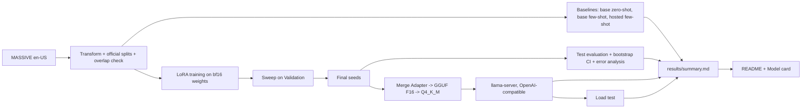

# Fine-Tune and Serve

**A small open model, fine-tuned with LoRA, beats prompting the same model and a hosted classification API at turning voice-assistant requests into structured JSON. It holds its accuracy after 4-bit quantization and serves 16 concurrent clients at P95 1353 ms on one consumer GPU.**

The model is `Qwen/Qwen2.5-1.5B-Instruct`. Given one English request such as "wake me up at seven tomorrow", it returns `{"intent": ..., "slots": [{"type": ..., "value": ...}]}`. The data is Amazon's MASSIVE dataset in its official splits. The project covers the whole path a model takes to production: baselines, a LoRA sweep with fixed seeds, test evaluation with confidence intervals and error analysis, quantization with llama.cpp, an OpenAI-compatible server, and a load test.

## Headline results

- **Fine-tuned** (mean ± standard deviation over 3 seeds): field-level F1 **0.8503 ± 0.0016** on the 2974 test examples.
- **Baselines** on the same test split and metric: base model zero-shot 0.3232 [0.3118, 0.3347], base model few-shot 0.3578 [0.3448, 0.3699], TypeSafe Jev (`jev-1.13.0`) few-shot 0.6872 [0.6745, 0.6996]. Jev is a hosted classification API: it selects the intent and slot spans, and code assembles the JSON. Each figure is the point estimate with its 95% bootstrap CI.
- **Quantized and served** with llama-server: GGUF F16 0.8501 [0.8394, 0.8600], GGUF Q4_K_M 0.8462 [0.8360, 0.8561]. Peak GPU memory while serving (whole-GPU `nvidia-smi` reading, including the desktop): 4859 MiB for F16, 2617 MiB for Q4_K_M.
- **Load test** (Q4_K_M on one RTX 3080, a single run of 128 timed requests per level): **16** concurrent clients sustained with no failed request, at P95 1353 ms. The load test measures latency and failures only; quality was measured one request at a time.


Every number in this file is generated. It comes from `results/summary.md` or `results/*.json`, and each of those records the command, seed and commit that produced it. `python scripts/build_docs.py` writes this README from `docs/README.template.md`, and `python scripts/check_traceability.py` fails if any number here cannot be traced to a generated file.

## What I built

- **Data pipeline:** MASSIVE records transformed into the JSON target, official splits checked for overlapping ids and shared utterance texts.
- **Metric:** field-level F1 over intent and (slot type, value) pairs, with a percentile bootstrap CI.
- **Baselines:** the base model zero-shot and few-shot, and a hosted classification API (TypeSafe Jev, span selection) behind a spend cap with a cost ledger.
- **Training:** LoRA with loss on the JSON tokens only, a hyperparameter sweep on Validation, then fixed-seed final runs and a determinism check.
- **Serving:** Adapter merge, GGUF conversion and Q4_K_M quantization with llama.cpp in Docker, `llama-server` behind an OpenAI-compatible API, quality re-measured through the server, and an async load test with a GPU-memory monitor.
- **Reproducibility:** every result file is stamped with its command, seed and commit, and the README and Model card are generated from those files.

## Quickstart (CPU only, from a fresh clone)

These steps need Linux, macOS or WSL2, Git and [uv](https://docs.astral.sh/uv/). They need no GPU, Docker, model download or API key. `uv sync` installs the locked environment, including PyTorch with its CUDA libraries, which is several GB.

```bash
git clone https://github.com/OctaviusLeo/Finetune-And-Serve.git
cd Finetune-And-Serve
uv sync --frozen
bash scripts/test_unit.sh
uv run --frozen python -m fts.smoke_eval
uv run --frozen python scripts/check_traceability.py
```

- `bash scripts/test_unit.sh` runs the unit and property tests (everything except the `gpu` and `docker` markers) and enforces 80% statement coverage per non-trivial module. The tests use tiny random models and fakes for `nvidia-smi`, Docker and HTTP.
- `python -m fts.smoke_eval` runs the data transform, splitter, overlap check and metric end to end on a fixed fixture and fails on any difference from the expected result.
- `python scripts/check_traceability.py` checks that every number in this README and the Model card appears in a committed result file.

**What a fresh clone cannot reproduce on CPU.** The trained LoRA Adapters, the merged model and the GGUF files are not in the repository: they are too large to commit and they are not published. Training writes the Adapters to `~/fts-artifacts/adapters/<run_id>/`, and quantization writes the merged model and GGUF files under `~/fts-artifacts/models/`. Recreating them, and every reported number, needs an NVIDIA GPU, Docker with the NVIDIA Container Toolkit, the base model from Hugging Face, and a `TYPESAFE_API_KEY` for the hosted baseline. The full pipeline is under [Commands](#commands).

## Architecture



- **Task and metric.** Input: one utterance. Output: `{"intent": ..., "slots": [{"type": ..., "value": ...}]}`. The score is field-level F1 over the multiset of (intent) and (slot type, value) pairs, with strings lowercased and whitespace collapsed. An invalid output scores 0. Range: 0 to 1. The intent counts as one pair alongside the slot pairs, and the reported score is the mean of the per-example F1 values, so it is not comparable to the intent accuracy or slot micro-F1 in the MASSIVE paper.
- **Data.** MASSIVE 1.1, English, in its official partitions: 11514 Train, 2033 Validation and 2974 Test examples, checked to be disjoint. The prompts list 60 intents and 55 slot types, built from the Train_Split only.
- **Training.** LoRA on all attention and MLP projections of the bf16 base model, with `max_seq_len` 256, per-device batch 4 and gradient accumulation 4 (effective batch 16). 2 epochs, linear decay with 3% warmup, LoRA dropout 0.05, gradient clipping 1.0. The loss covers the JSON tokens only, and the seeds are fixed. A 3-config sweep selects the configuration on Validation F1, and that configuration is trained with seeds 1, 2, 3.
- **Evaluation.** Hugging Face `transformers` in bf16 with greedy decoding (`max_new_tokens` 128). Each metric gets a 95% percentile bootstrap CI from 1000 resamples. Every Test failure of the serving seed is grouped by type.
- **Serving.** The serving seed's Adapter is merged into the base model, converted to GGUF F16 and quantized to GGUF Q4_K_M with llama.cpp `b11580`. It is served by `llama-server` in Docker on port 8080 with 32 slots.

## Results

The tables below are the sections of `results/summary.md`.

### Test F1: baselines and fine-tuned seeds

| System | Prompt | Test F1 [95% CI] | Not scored |
| --- | --- | --- | --- |
| Base zero-shot | zero-shot | 0.3232 [0.3118, 0.3347] | 0 |
| Base few-shot | few-shot (10 exemplars) | 0.3578 [0.3448, 0.3699] | 0 |
| Hosted few-shot (TypeSafe Jev) | few-shot (10 exemplars) | 0.6872 [0.6745, 0.6996] | 0 |
| Fine-tuned, seed 1 | compact | 0.8516 [0.8411, 0.8607] | 0 |
| Fine-tuned, seed 2 | compact | 0.8508 [0.8402, 0.8604] | 0 |
| Fine-tuned, seed 3 | compact | 0.8485 [0.8381, 0.8579] | 0 |
| Fine-tuned, mean ± std over 3 seeds | compact | 0.8503 ± 0.0016 | |

Every system is scored on the same Test_Split with the same field-level F1; each uses its own recorded prompt template.

Source `results/baselines.json`; command `python -m fts.baselines --baseline hosted_few_shot`, seed `0`, commit `93cd217aa7743b458b9c3da497791e4633f56386`.

Source `results/finetuned.json`; command `python -m fts.eval`, seed `0`, commit `4e37f1be3ac2763570c4003ee343d59076f9be41`.


### Sweep

| Config | lora_r | lora_alpha | Learning rate | Validation F1 |
| --- | --- | --- | --- | --- |
| A | 8 | 16 | 0.0002 | 0.8390 |
| B (selected) | 16 | 32 | 0.0002 | 0.8407 |
| C | 16 | 32 | 0.0001 | 0.8340 |

Selection: highest Validation F1; ties go to the config listed first. Rationale: `docs/SWEEP_RATIONALE.md`.

Final_Configuration Validation F1: seed 1 0.8407, seed 2 0.8450, seed 3 0.8429; serving seed 2.

Source `results/final_runs.json`; command `python -m fts.sweep final`, seed `1`, commit `2538faa3850db6c1902b6fcb4d9f44119879afd2`.

Source `results/sweep.json`; command `python -m fts.sweep sweep`, seed `1`, commit `2538faa3850db6c1902b6fcb4d9f44119879afd2`.

### Quantization quality

| Model (llama-server) | Test F1 [95% CI] | Failed requests | Peak VRAM / total (MiB) |
| --- | --- | --- | --- |
| GGUF F16 (pre-quantization) | 0.8501 [0.8394, 0.8600] | 0 | 4859 / 10240 |
| GGUF Q4_K_M (4-bit nominal) | 0.8462 [0.8360, 0.8561] | 0 | 2617 / 10240 |

Reference: the same seed (2) evaluated with Hugging Face transformers: 0.8508 [0.8402, 0.8604]. Numbers are compared only within one engine.

Q4_K_M file: 986048064 bytes, 5.11 bits per weight by size (F16: 16.03); llama-quantize reports 5.08 BPW.

Source `results/quantization.json`; command `python -m fts.quantize`, seed `2`, commit `e47011f37ab925ba66d7ec4d0929b0cb53712ae4`.

Source `results/quant_quality.json`; command `python -m fts.quant_quality`, seed `0`, commit `e47011f37ab925ba66d7ec4d0929b0cb53712ae4`.

### Load test

Schedule: concurrency levels 1, 2, 4, 8, 16, 32. At each level, 5 warm-up requests and 128 timed requests are sent, with a 60 s timeout and `max_tokens` 128. Latency percentiles and tokens/s count successful requests only. A level is sustained when no request fails and P95 is at or below 2000 ms. The schedule was run once, and it records latency, throughput and failures, not output quality.

| Concurrency | P50 (ms) | P95 (ms) | Tokens/s | Failed | Sustained |
| --- | --- | --- | --- | --- | --- |
| 1 | 111 | 207 | 239.7 | 0 | yes |
| 2 | 167 | 266 | 312.7 | 0 | yes |
| 4 | 281 | 484 | 358.7 | 0 | yes |
| 8 | 466 | 858 | 435.0 | 0 | yes |
| 16 | 738 | 1353 | 497.3 | 0 | yes |
| 32 | 1356 | 2843 | 515.1 | 0 | no |

Maximum sustained concurrency: **16** (no failed request and P95 <= 2000 ms). Peak VRAM during the test: 2642 of 10240 MiB.

Source `results/loadtest.json`; command `python scripts/loadtest.py`, seed `0`, commit `45a605d82be8518b86c5eba168578d099236d601`.

### Error analysis

| Failure group | Count |
| --- | --- |
| invalid_output | 0 |
| wrong_intent | 293 |
| missing_slot | 267 |
| extra_slot | 188 |
| wrong_slot_value | 112 |
| **Total analyzed** | 860 |

Every Test failure (F1 < 1) of the serving seed (2) is assigned to the first matching group.

Source `results/error_analysis.json`; command `python -m fts.eval`, seed `0`, commit `4e37f1be3ac2763570c4003ee343d59076f9be41`.

### Data

| Split | Examples |
| --- | --- |
| Train | 11514 |
| Validation | 2033 |
| Test | 2974 |

Excluded as malformed: 0. Overlapping example ids across splits: 0. Utterance texts shared train/validation 11, train/test 21, validation/test 5.

Source `results/data_counts.json`; command `python scripts/build_data.py`, seed `0`, commit `fd1f18e7141320f836000a4a81f0b274ffb84186`.

### Hosted spend

Hosted few-shot baseline: $1.8624; hosted ledger total $1.8711 against the Spend_Cap of $2.00 (prompt tokens charged at $0.042 and completion tokens at $0.0 per 1M tokens, an upper bound on the bill).

Source `results/baselines.json`; command `python -m fts.baselines --baseline hosted_few_shot`, seed `0`, commit `93cd217aa7743b458b9c3da497791e4633f56386`.

## Commands

The full pipeline was run inside WSL2 (`Ubuntu-24.04`) through a wrapper that selects the project environment and sets `FTS_ARTIFACTS=~/fts-artifacts`. From the repository root, each command below is written as `<command>` in:

```bash
bash scripts/wsl_run.sh <command>
```

| What | Single command |
| --- | --- |
| Unit and property tests (CPU, with the per-module coverage rule) | `bash scripts/test_unit.sh` |
| CPU smoke evaluation | `python -m fts.smoke_eval` |
| Start the serving endpoint (Q4_K_M by default, or `f16`; needs the GGUF files) | `bash scripts/serve.sh` |
| Data counts and splits (`results/data_counts.json`) | `python scripts/build_data.py` |
| GPU-memory dry run (`docs/ENVIRONMENT.md`) | `python scripts/dry_run.py` |
| Baselines (`results/baselines.json`) | `python -m fts.baselines --baseline all` |
| Sweep (`results/sweep.json`) | `python -m fts.sweep sweep` |
| Final seeds (`results/final_runs.json`) | `python -m fts.sweep final` |
| Training determinism (`results/train_determinism.json`) | `python scripts/check_train_determinism.py` |
| Test evaluation and error analysis (`results/finetuned.json`, `results/error_analysis.json`) | `python -m fts.eval` |
| Quantization (`results/quantization.json`) | `python -m fts.quantize` |
| Pre/post-quantization quality (`results/quant_quality.json`) | `python -m fts.quant_quality` |
| Load test (`results/loadtest.json`) | `python scripts/loadtest.py` |
| Results table and plots (`results/summary.md`) | `python scripts/build_summary.py` |
| This README and the Model card | `python scripts/build_docs.py` |
| Number traceability check | `python scripts/check_traceability.py` |

**CI.** GitHub Actions runs the unit tests and the smoke evaluation on every push and pull request, on a GitHub-hosted `ubuntu-latest` runner with no GPU and no secrets. Modules with more than one public function or long bodies must reach 80% statement coverage. Environment versions and evidence are in `docs/ENVIRONMENT.md`.

## Repository layout

| Path | Contents |
| --- | --- |
| `fts/` | The library: data, metric, prompts, baselines, training, evaluation, quantization, serving client, load test, reporting |
| `scripts/` | Thin command-line entry points, the test runner, the serving script and WSL helpers |
| `tests/` | Unit and property tests, with fixtures |
| `config/` | Model, training, sweep, serving, load-test and hosted-baseline settings, prompts and labels |
| `data/massive_en/` | The transformed English MASSIVE records (CC BY 4.0) |
| `results/` | Generated result files, plots and `summary.md`, each stamped with command, seed and commit |
| `docs/` | README and Model card templates, environment record, sweep rationale |
| `MODEL_CARD.md` | Intended use, data, metrics, failure modes and limitations |
| `.kiro/specs/` | The requirements, design and task list the project was built from |

## Known limitations

- **Each system has its own prompt.** The base and hosted baselines see the full intent and slot-type lists plus 10 exemplars from the Train_Split. The fine-tuned model sees a compact prompt. The comparison is between documented systems on the same Test_Split and metric.
- **The hosted baseline selects; it does not generate.** TypeSafe's Jev returns typed probabilities, so it picks the intent from the label list and, for each candidate span of up to 6 words, a slot type or none; code assembles the JSON and resolves overlapping spans. Slot values longer than that cannot be produced. The version is pinned to `jev-1.13.0`, and each response's `model` field is recorded.
- **Duplicate utterances.** MASSIVE's official partitions share some utterance texts. The counts are in the Data section.
- **Two inference engines.** Training-stage numbers come from Hugging Face `transformers` in bf16. The pre/post-quantization comparison and the load test use `llama-server`. Numbers are compared only within one engine.
- **"4-bit" is nominal.** Q4_K_M mixes 4-bit and higher-precision k-quant blocks. The measured bits per weight are in the Quantization section.
- **GPU memory is an upper bound.** It is `nvidia-smi`'s whole-GPU reading, so it includes the desktop and any other program on the GPU, not only `llama-server`.
- **One GPU under WSL2.** Latency and throughput are specific to an RTX 3080 under WSL2 with the compact prompt and short outputs, and other programs shared the GPU.
- **Weights are not published.** A fresh clone can run the tests and the smoke evaluation, but not the trained model.

## How this was built

This project was built with Claude Code (Anthropic's agentic coding tool) under a spec-driven workflow: written requirements, then a design, then a task list organized into milestones (the spec files under `.kiro/specs/`), each milestone ending in an automated gate script that had to pass before the next one started. The commit history shows this openly; commits carry a `Co-Authored-By` trailer naming the model that helped write them. Every reported number comes from a script in this repository and records the command, seed and commit that produced it, so nothing was typed, estimated or borrowed. I set the goals and constraints in the specification, I am accountable for the verification and the results, and I can explain and change any part of this code.

## License

Code is released under the [MIT License](LICENSE). Third-party packages, data and models are listed with their licenses in [THIRD_PARTY.md](THIRD_PARTY.md). MASSIVE is by FitzGerald et al. (Amazon) and SLURP by Bastianelli et al., both licensed CC BY 4.0; `data/massive_en/` is a transformed copy of the English records. There is no published package or release, and the fine-tuned weights and LoRA Adapters are not published.
