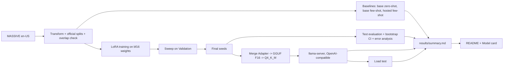

# Fine-Tune and Serve

**This repository is private.** It has no public license, no published package and no public release, and the fine-tuned weights and LoRA Adapters are not published.

This project fine-tunes `{{base_model}}` with LoRA on one narrow task: turning an English voice-assistant request into intent-and-slot JSON, using the MASSIVE dataset. It measures whether that beats prompting the base model and a hosted model on the same Test_Split and metric. It then quantizes the fine-tuned model with llama.cpp, serves it behind an OpenAI-compatible endpoint, and load-tests it on one RTX 3080.

Every number in this file is generated. It comes from `results/summary.md` or `results/*.json`, and each of those records the command, seed and commit that produced it. `python scripts/build_docs.py` writes this README from `docs/README.template.md`, and `python scripts/check_traceability.py` fails if any number here cannot be traced to a generated file.

## Headline

- **Fine-tuned** (mean ± standard deviation over {{n_final_seeds}} seeds): field-level F1 **{{f1_ft_mean}} ± {{f1_ft_spread}}** on the {{n_test}} Test examples.
- **Baselines** on the same Test_Split and metric: base model zero-shot {{f1_zero_shot}}, base model few-shot {{f1_few_shot}}, hosted `{{hosted_model}}` few-shot {{f1_hosted}}. Each figure is the point estimate with its {{ci_percent}}% bootstrap CI.
- **Served** with llama-server: GGUF F16 {{f1_f16}}, GGUF Q4_K_M {{f1_q4}}. Maximum sustained concurrency in the load test: **{{max_concurrency}}**.

## Architecture



- **Task and metric.** Input: one utterance. Output: `{"intent": ..., "slots": [{"type": ..., "value": ...}]}`. The score is field-level F1 over the multiset of (intent) and (slot type, value) pairs, with strings lowercased and whitespace collapsed. An invalid output scores 0. Range: 0 to 1.
- **Data.** MASSIVE 1.1, English, in its official partitions: {{n_train}} Train, {{n_validation}} Validation and {{n_test}} Test examples, checked to be disjoint. The prompts list {{n_intents}} intents and {{n_slot_types}} slot types, built from the Train_Split only.
- **Training.** LoRA on all attention and MLP projections of the bf16 base model, with `max_seq_len` {{max_seq_len}}, per-device batch {{per_device_batch_size}} and gradient accumulation {{grad_accum}} (effective batch {{effective_batch}}). {{epochs}} epochs, linear decay with {{warmup_percent}}% warmup, LoRA dropout {{lora_dropout}}, gradient clipping {{max_grad_norm}}. The loss covers the JSON tokens only, and the seeds are fixed. A {{n_sweep_configs}}-config sweep selects the configuration on Validation F1, and that configuration is trained with seeds {{final_seeds}}.
- **Evaluation.** Hugging Face `transformers` in bf16 with greedy decoding (`max_new_tokens` {{max_new_tokens}}). Each metric gets a {{ci_percent}}% percentile bootstrap CI from {{bootstrap_resamples}} resamples. Every Test failure of the serving seed is grouped by type.
- **Serving.** The serving seed's Adapter is merged into the base model, converted to GGUF F16 and quantized to GGUF Q4_K_M with llama.cpp `{{llama_cpp_build}}`. It is served by `llama-server` in Docker on port {{serve_port}} with {{serve_slots}} slots.

## Results

The tables below are the sections of `results/summary.md`.

### Test F1: baselines and fine-tuned seeds

{{summary_test}}


### Sweep

{{summary_sweep}}

### Quantization quality

{{summary_quant}}

### Load test

Schedule: concurrency levels {{loadtest_levels}}. At each level, {{loadtest_warmup}} warm-up requests and {{loadtest_timed}} timed requests are sent, with a {{loadtest_timeout_s}} s timeout and `max_tokens` {{loadtest_max_tokens}}. Latency percentiles and tokens/s count successful requests only. A level is sustained when no request fails and P95 is at or below {{loadtest_p95_limit_ms}} ms.

{{summary_load}}

### Error analysis

{{summary_errors}}

### Data

{{summary_data}}

### Hosted spend

{{summary_spend}}

## Commands

Everything runs inside WSL `Ubuntu-24.04` through the wrapper. Each command below is written as `<command>` in:

```
wsl -d Ubuntu-24.04 -- bash /mnt/c/dev/Finetune-And-Serve/scripts/wsl_run.sh <command>
```

| What | Single command |
| --- | --- |
| Unit and property tests (CPU, with the per-module coverage rule) | `bash scripts/test_unit.sh` |
| CPU Smoke_Evaluation | `python -m fts.smoke_eval` |
| Start the Serving_Endpoint (Q4_K_M by default, or `f16`) | `bash scripts/serve.sh` |
| Data counts and splits (`results/data_counts.json`) | `python scripts/build_data.py` |
| VRAM Dry_Run (`docs/ENVIRONMENT.md`) | `python scripts/dry_run.py` |
| Baselines (`results/baselines.json`) | `python -m fts.baselines --baseline all` |
| Sweep (`results/sweep.json`) | `python -m fts.sweep sweep` |
| Final seeds (`results/final_runs.json`) | `python -m fts.sweep final` |
| Training determinism (`results/train_determinism.json`) | `python scripts/check_train_determinism.py` |
| Test evaluation and error analysis (`results/finetuned.json`, `results/error_analysis.json`) | `python -m fts.eval` |
| Quantization (`results/quantization.json`) | `python -m fts.quantize` |
| Pre/post-quantization quality (`results/quant_quality.json`) | `python -m fts.quant_quality` |
| Load test (`results/loadtest.json`) | `python scripts/loadtest.py` |
| Results table and plots (`results/summary.md`) | `python scripts/build_summary.py` |
| This README and the Model card | `python scripts/build_docs.py` |
| Number traceability check | `python scripts/check_traceability.py` |

CI (GitHub Actions on `ubuntu-latest`) runs the unit tests and the Smoke_Evaluation on every push and pull request. Modules with more than one public function or long bodies must reach {{coverage_percent}}% statement coverage. Environment versions and evidence are in `docs/ENVIRONMENT.md`, and licenses are in `THIRD_PARTY.md`.

## Known limitations

- **Each system has its own prompt.** The base and hosted baselines see the full intent and slot-type lists plus {{n_exemplars}} exemplars from the Train_Split. The fine-tuned model sees a compact prompt. The comparison is between documented systems on the same Test_Split and metric.
- **Hosted model alias.** `{{hosted_model}}` is an alias, and OpenAI retires models. The results describe the model that answered on the run date, and its `model` field is recorded.
- **Duplicate utterances.** MASSIVE's official partitions share some utterance texts. The counts are in the Data section.
- **Two inference engines.** Training-stage numbers come from Hugging Face `transformers` in bf16. The pre/post-quantization comparison and the load test use `llama-server`. Numbers are compared only within one engine.
- **"4-bit" is nominal.** Q4_K_M mixes 4-bit and higher-precision k-quant blocks. The measured bits per weight are in the Quantization section.
- **One GPU under WSL2.** Latency and throughput are specific to an RTX 3080 under WSL2 with the compact prompt and short outputs, and other programs shared the GPU.
- **Weights are not published.**
