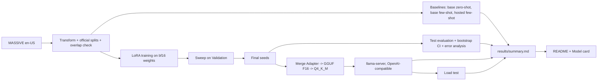

# Fine-Tune and Serve

**A small open model, fine-tuned with LoRA, beats prompting the same model and a hosted model at turning voice-assistant requests into structured JSON, and still holds its accuracy after 4-bit quantization and under concurrent load on one consumer GPU.**

The model is `{{base_model}}`. Given one English request such as "wake me up at seven tomorrow", it returns `{"intent": ..., "slots": [{"type": ..., "value": ...}]}`. The data is Amazon's MASSIVE dataset in its official splits. The project covers the whole path a model takes to production: baselines, a LoRA sweep with fixed seeds, test evaluation with confidence intervals and error analysis, quantization with llama.cpp, an OpenAI-compatible server, and a load test.

## Headline results

- **Fine-tuned** (mean ± standard deviation over {{n_final_seeds}} seeds): field-level F1 **{{f1_ft_mean}} ± {{f1_ft_spread}}** on the {{n_test}} test examples.
- **Baselines** on the same test split and metric: base model zero-shot {{f1_zero_shot}}, base model few-shot {{f1_few_shot}}, TypeSafe Jev (`{{hosted_model}}`) few-shot {{f1_hosted}}. Each figure is the point estimate with its {{ci_percent}}% bootstrap CI.
- **Quantized and served** with llama-server: GGUF F16 {{f1_f16}}, GGUF Q4_K_M {{f1_q4}}. Peak GPU memory while serving: {{vram_f16}} MiB for F16, {{vram_q4}} MiB for Q4_K_M.
- **Load test** (Q4_K_M on one RTX 3080): **{{max_concurrency}}** concurrent clients sustained with no failed request, at P95 {{p95_max_concurrency}} ms.


Every number in this file is generated. It comes from `results/summary.md` or `results/*.json`, and each of those records the command, seed and commit that produced it. `python scripts/build_docs.py` writes this README from `docs/README.template.md`, and `python scripts/check_traceability.py` fails if any number here cannot be traced to a generated file.

## What I built

- **Data pipeline:** MASSIVE records transformed into the JSON target, official splits checked for overlapping ids and shared utterance texts.
- **Metric:** field-level F1 over intent and (slot type, value) pairs, with a percentile bootstrap CI.
- **Baselines:** the base model zero-shot and few-shot, and a hosted model behind a spend cap with a cost ledger.
- **Training:** LoRA with loss on the JSON tokens only, a hyperparameter sweep on Validation, then fixed-seed final runs and a determinism check.
- **Serving:** Adapter merge, GGUF conversion and Q4_K_M quantization with llama.cpp in Docker, `llama-server` behind an OpenAI-compatible API, quality re-measured through the server, and an async load test with a GPU-memory monitor.
- **Reproducibility:** every result file is stamped with its command, seed and commit, and the README and Model card are generated from those files.

## Quickstart (CPU only, from a fresh clone)

These steps need Linux, macOS or WSL2, Git and [uv](https://docs.astral.sh/uv/). They need no GPU, Docker, model download or API key. `uv sync` installs the locked environment, including PyTorch with its CUDA libraries, which is several GB.

```bash
git clone https://github.com/OctaviusLeo/Finetune-And-Serve.git
cd Finetune-And-Serve
uv sync --frozen
bash scripts/test_unit.sh
uv run --frozen python -m fts.smoke_eval
uv run --frozen python scripts/check_traceability.py
```

- `bash scripts/test_unit.sh` runs the unit and property tests (everything except the `gpu` and `docker` markers) and enforces {{coverage_percent}}% statement coverage per non-trivial module. The tests use tiny random models and fakes for `nvidia-smi`, Docker and HTTP.
- `python -m fts.smoke_eval` runs the data transform, splitter, overlap check and metric end to end on a fixed fixture and fails on any difference from the expected result.
- `python scripts/check_traceability.py` checks that every number in this README and the Model card appears in a committed result file.

**What a fresh clone cannot reproduce on CPU.** The trained LoRA Adapters, the merged model and the GGUF files are not in the repository: they are too large to commit and they are not published. Training writes the Adapters to `~/fts-artifacts/adapters/<run_id>/`, and quantization writes the merged model and GGUF files under `~/fts-artifacts/models/`. Recreating them, and every reported number, needs an NVIDIA GPU, Docker with the NVIDIA Container Toolkit, the base model from Hugging Face, and a `TYPESAFE_API_KEY` for the hosted baseline. The full pipeline is under [Commands](#commands).

## Architecture



- **Task and metric.** Input: one utterance. Output: `{"intent": ..., "slots": [{"type": ..., "value": ...}]}`. The score is field-level F1 over the multiset of (intent) and (slot type, value) pairs, with strings lowercased and whitespace collapsed. An invalid output scores 0. Range: 0 to 1.
- **Data.** MASSIVE 1.1, English, in its official partitions: {{n_train}} Train, {{n_validation}} Validation and {{n_test}} Test examples, checked to be disjoint. The prompts list {{n_intents}} intents and {{n_slot_types}} slot types, built from the Train_Split only.
- **Training.** LoRA on all attention and MLP projections of the bf16 base model, with `max_seq_len` {{max_seq_len}}, per-device batch {{per_device_batch_size}} and gradient accumulation {{grad_accum}} (effective batch {{effective_batch}}). {{epochs}} epochs, linear decay with {{warmup_percent}}% warmup, LoRA dropout {{lora_dropout}}, gradient clipping {{max_grad_norm}}. The loss covers the JSON tokens only, and the seeds are fixed. A {{n_sweep_configs}}-config sweep selects the configuration on Validation F1, and that configuration is trained with seeds {{final_seeds}}.
- **Evaluation.** Hugging Face `transformers` in bf16 with greedy decoding (`max_new_tokens` {{max_new_tokens}}). Each metric gets a {{ci_percent}}% percentile bootstrap CI from {{bootstrap_resamples}} resamples. Every Test failure of the serving seed is grouped by type.
- **Serving.** The serving seed's Adapter is merged into the base model, converted to GGUF F16 and quantized to GGUF Q4_K_M with llama.cpp `{{llama_cpp_build}}`. It is served by `llama-server` in Docker on port {{serve_port}} with {{serve_slots}} slots.

## Results

The tables below are the sections of `results/summary.md`.

### Test F1: baselines and fine-tuned seeds

{{summary_test}}


### Sweep

{{summary_sweep}}

### Quantization quality

{{summary_quant}}

### Load test

Schedule: concurrency levels {{loadtest_levels}}. At each level, {{loadtest_warmup}} warm-up requests and {{loadtest_timed}} timed requests are sent, with a {{loadtest_timeout_s}} s timeout and `max_tokens` {{loadtest_max_tokens}}. Latency percentiles and tokens/s count successful requests only. A level is sustained when no request fails and P95 is at or below {{loadtest_p95_limit_ms}} ms.

{{summary_load}}

### Error analysis

{{summary_errors}}

### Data

{{summary_data}}

### Hosted spend

{{summary_spend}}

## Commands

The full pipeline was run inside WSL2 (`Ubuntu-24.04`) through a wrapper that selects the project environment and sets `FTS_ARTIFACTS=~/fts-artifacts`. From the repository root, each command below is written as `<command>` in:

```bash
bash scripts/wsl_run.sh <command>
```

| What | Single command |
| --- | --- |
| Unit and property tests (CPU, with the per-module coverage rule) | `bash scripts/test_unit.sh` |
| CPU smoke evaluation | `python -m fts.smoke_eval` |
| Start the serving endpoint (Q4_K_M by default, or `f16`; needs the GGUF files) | `bash scripts/serve.sh` |
| Data counts and splits (`results/data_counts.json`) | `python scripts/build_data.py` |
| GPU-memory dry run (`docs/ENVIRONMENT.md`) | `python scripts/dry_run.py` |
| Baselines (`results/baselines.json`) | `python -m fts.baselines --baseline all` |
| Sweep (`results/sweep.json`) | `python -m fts.sweep sweep` |
| Final seeds (`results/final_runs.json`) | `python -m fts.sweep final` |
| Training determinism (`results/train_determinism.json`) | `python scripts/check_train_determinism.py` |
| Test evaluation and error analysis (`results/finetuned.json`, `results/error_analysis.json`) | `python -m fts.eval` |
| Quantization (`results/quantization.json`) | `python -m fts.quantize` |
| Pre/post-quantization quality (`results/quant_quality.json`) | `python -m fts.quant_quality` |
| Load test (`results/loadtest.json`) | `python scripts/loadtest.py` |
| Results table and plots (`results/summary.md`) | `python scripts/build_summary.py` |
| This README and the Model card | `python scripts/build_docs.py` |
| Number traceability check | `python scripts/check_traceability.py` |

**CI.** GitHub Actions runs the unit tests and the smoke evaluation on every push and pull request, on a GitHub-hosted `ubuntu-latest` runner with no GPU and no secrets. Modules with more than one public function or long bodies must reach {{coverage_percent}}% statement coverage. Environment versions and evidence are in `docs/ENVIRONMENT.md`.

## Repository layout

| Path | Contents |
| --- | --- |
| `fts/` | The library: data, metric, prompts, baselines, training, evaluation, quantization, serving client, load test, reporting |
| `scripts/` | Thin command-line entry points, the test runner, the serving script and WSL helpers |
| `tests/` | Unit and property tests, with fixtures |
| `config/` | Model, training, sweep, serving, load-test and hosted-baseline settings, prompts and labels |
| `data/massive_en/` | The transformed English MASSIVE records (CC BY 4.0) |
| `results/` | Generated result files, plots and `summary.md`, each stamped with command, seed and commit |
| `docs/` | README and Model card templates, environment record, sweep rationale |
| `MODEL_CARD.md` | Intended use, data, metrics, failure modes and limitations |
| `.kiro/specs/` | The requirements, design and task list the project was built from |

## Known limitations

- **Each system has its own prompt.** The base and hosted baselines see the full intent and slot-type lists plus {{n_exemplars}} exemplars from the Train_Split. The fine-tuned model sees a compact prompt. The comparison is between documented systems on the same Test_Split and metric.
- **The hosted baseline selects; it does not generate.** TypeSafe's Jev returns typed probabilities, so it picks the intent from the label list and, for each candidate span of up to {{hosted_max_span_tokens}} words, a slot type or none; code assembles the JSON and resolves overlapping spans. Slot values longer than that cannot be produced. The version is pinned to `{{hosted_model}}`, and each response's `model` field is recorded.
- **Duplicate utterances.** MASSIVE's official partitions share some utterance texts. The counts are in the Data section.
- **Two inference engines.** Training-stage numbers come from Hugging Face `transformers` in bf16. The pre/post-quantization comparison and the load test use `llama-server`. Numbers are compared only within one engine.
- **"4-bit" is nominal.** Q4_K_M mixes 4-bit and higher-precision k-quant blocks. The measured bits per weight are in the Quantization section.
- **GPU memory is an upper bound.** It is `nvidia-smi`'s whole-GPU reading, so it includes the desktop and any other program on the GPU, not only `llama-server`.
- **One GPU under WSL2.** Latency and throughput are specific to an RTX 3080 under WSL2 with the compact prompt and short outputs, and other programs shared the GPU.
- **Weights are not published.** A fresh clone can run the tests and the smoke evaluation, but not the trained model.

## How this was built

This project was built with Claude Code (Anthropic's agentic coding tool) under a spec-driven workflow: written requirements, then a design, then a task list organized into milestones (the spec files under `.kiro/specs/`), each milestone ending in an automated gate script that had to pass before the next one started. The commit history shows this openly; commits carry a `Co-Authored-By` trailer naming the model that helped write them. Every reported number comes from a script in this repository and records the command, seed and commit that produced it, so nothing was typed, estimated or borrowed. I set the goals and constraints in the specification, I am accountable for the verification and the results, and I can explain and change any part of this code.

## License

Code is released under the [MIT License](LICENSE). Third-party packages, data and models are listed with their licenses in [THIRD_PARTY.md](THIRD_PARTY.md). MASSIVE is by FitzGerald et al. (Amazon) and SLURP by Bastianelli et al., both licensed CC BY 4.0; `data/massive_en/` is a transformed copy of the English records. There is no published package or release, and the fine-tuned weights and LoRA Adapters are not published.
